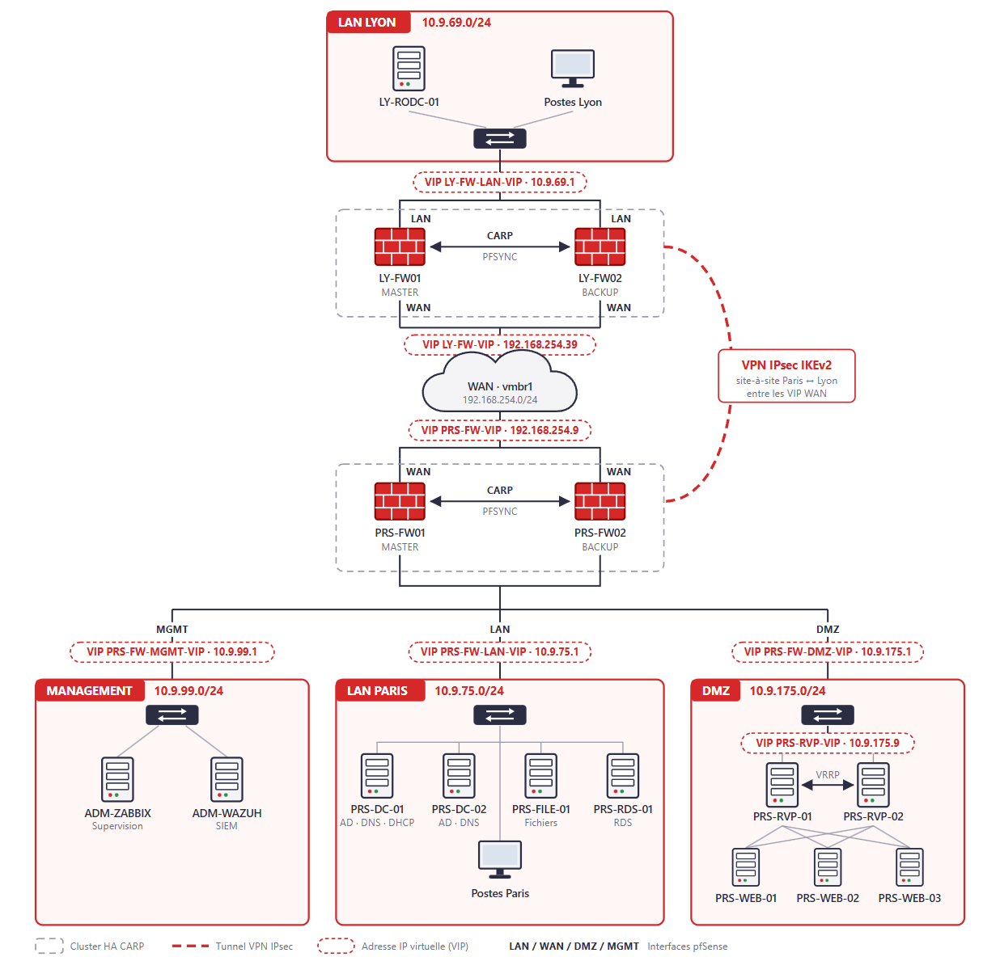

# Architecture : conception et maquettage de l'infrastructure

[← Retour au projet](../README.md) · [Réseau →](1-reseau.md)

## Introduction

Le système d'information existant de Freemotion s'est construit par développements ponctuels, sans architecture réseau formalisée. Postes, serveurs et accès d'administration cohabitent sur un même réseau plat, sans pare-feu dédié ni détection d'intrusion. L'authentification n'est pas centralisée, aucune supervision ne permet de détecter une panne ou une intrusion, et aucune stratégie de sauvegarde ne protège les données.

Ces limites deviennent critiques avec l'ouverture du site de Lyon : sans liaison sécurisée, chaque agence fonctionnerait comme un îlot isolé, avec sa propre gestion des comptes et sa propre exposition aux menaces.

L'architecture répond à ces constats par trois couches complémentaires :

- un **socle réseau segmenté et redondant** : pare-feux en haute disponibilité et tunnel VPN chiffré entre Paris et Lyon ;
- une **identité centralisée** sur les deux sites : Active Directory multisite, avec un contrôleur en lecture seule à Lyon ;
- une **couche transverse de sécurité et de supervision** : détection d'intrusion, audit, surveillance et réponse aux incidents.

---

## Principes d'architecture

| Principe                  | Application dans le projet                                                                                     |
|---------------------------|----------------------------------------------------------------------------------------------------------------|
| **Security by Design**    | La sécurité est intégrée dès la conception de chaque couche, et non ajoutée a posteriori                       |
| **Défense en profondeur** | Barrières successives : pare-feu, IDS/IPS, filtrage GeoIP et DNS, segmentation, durcissement de l'annuaire     |
| **Haute disponibilité**   | Aucun point de défaillance unique sur les composants critiques : pfSense en CARP, DC redondés, reverse proxy en VRRP |
| **Segmentation stricte**  | Zones réseau isolées, aucun flux inter-zone sans règle explicite                                               |
| **Moindre privilège**     | Interfaces d'administration isolées dans la zone Management, comptes d'administration nominatifs               |

---

## Architecture générale

L'architecture s'organise autour de deux paires de pare-feu **pfSense** en configuration **CARP**, l'une à Paris et l'autre à Lyon. Chaque paire bascule automatiquement du nœud Master vers le nœud Backup en cas de panne, sans interruption du filtrage.

Un **tunnel VPN IPsec IKEv2** interconnecte les deux sites de façon permanente et chiffrée. En production, ce tunnel s'appuierait sur deux liens Internet physiques distincts. En maquette, il transite par le bridge WAN partagé de l'hyperviseur.

La **DMZ** héberge exclusivement les services exposés (reverse proxy HAProxy et serveurs web Nginx) : aucun flux ne peut être initié depuis la DMZ vers le LAN. La zone **Management**, strictement isolée, concentre les outils de supervision et de détection.

Les briques prévues dans l'architecture cible mais non déployées (sauvegarde, cloud, gestion de parc, tableaux de bord) sont présentées dans la page [Perspectives d'évolution](7-perspectives.md).

---

## Plan d'adressage et segmentation

Le plan d'adressage respecte la **RFC 1918** et évite volontairement les plages par défaut les plus courantes (`192.168.0.0/24`, `192.168.1.0/24`), afin de réduire les risques de collision lors d'interconnexions futures, par exemple avec un réseau domestique en télétravail ou avec un partenaire.

Chaque zone dispose de son propre sous-réseau. Tout flux inter-zone transite obligatoirement par les règles de filtrage pfSense, et la passerelle de chaque zone est une **adresse IP virtuelle (VIP) CARP**, qui reste disponible quel que soit le nœud actif.

| Zone           | Sous-réseau        | Passerelle (VIP) | Rôle                                                   |
|----------------|--------------------|------------------|--------------------------------------------------------|
| LAN Paris      | `10.9.75.0/24`     | `10.9.75.1`      | Postes du siège, serveurs internes (AD, fichiers, RDS) |
| DMZ Paris      | `10.9.175.0/24`    | `10.9.175.1`     | Services exposés (HAProxy, Nginx)                      |
| Management     | `10.9.99.0/24`     | `10.9.99.1`      | Supervision, SIEM, administration                      |
| LAN Lyon       | `10.9.69.0/24`     | `10.9.69.1`      | Postes de la succursale, RODC                          |
| WAN (maquette) | `192.168.254.0/24` | -                | Lien Internet simulé                                   |

La synchronisation de chaque cluster pfSense passe par un lien dédié, isolé des zones de production :

| Cluster | Sous-réseau     | Nœud 1                    | Nœud 2                    |
|---------|-----------------|---------------------------|---------------------------|
| Paris   | `10.9.250.0/30` | `PRS-FW01` - `10.9.250.1` | `PRS-FW02` - `10.9.250.2` |
| Lyon    | `10.9.250.4/30` | `LY-FW01` - `10.9.250.5`  | `LY-FW02` - `10.9.250.6`  |

Seules les VIP sont référencées dans les règles NAT et la configuration VPN : les adresses physiques des pare-feux ne sont jamais exposées directement.

### Serveurs principaux

| Zone       | Serveur            | Adresse IP       | Rôle                                     |
|------------|--------------------|------------------|------------------------------------------|
| LAN Paris  | `PRS-DC-01`        | `10.9.75.10`     | Contrôleur de domaine principal          |
| LAN Paris  | `PRS-DC-02`        | `10.9.75.11`     | Contrôleur de domaine secondaire         |
| LAN Paris  | `PRS-FILE-01`      | `10.9.75.20`     | Serveur de fichiers                      |
| LAN Paris  | `PRS-RDS-01`       | `10.9.75.21`     | Serveur RDS RemoteApp                    |
| LAN Lyon   | `LY-RODC-01`       | `10.9.69.10`     | Contrôleur de domaine en lecture seule   |
| DMZ        | `PRS-RVP-01`       | `10.9.175.10`    | Reverse proxy HAProxy (VIP `10.9.175.9`) |
| DMZ        | `PRS-RVP-02`       | `10.9.175.11`    | Reverse proxy HAProxy (VIP `10.9.175.9`) |
| DMZ        | `PRS-WEB-01`       | `10.9.175.20`    | Serveurs web Nginx                       |
| DMZ        | `PRS-WEB-02`       | `10.9.175.21`    | Serveurs web Nginx                       |
| DMZ        | `PRS-WEB-03`       | `10.9.175.22`    | Serveurs web Nginx                       |
| Management | `ADM-ZABBIX`       | `10.9.99.10`     | Supervision                              |
| Management | `ADM-WAZUH`        | `10.9.99.12`     | SIEM                                     |

Les serveurs sont en adressage fixe. La plage DHCP exclut les 99 premières adresses de chaque LAN, réservées aux équipements à adresse fixe actuels et futurs.

---

## Environnement de maquettage

### Hyperviseur et isolation des sites

L'infrastructure est maquettée sur un hyperviseur **Proxmox VE** mutualisé entre plusieurs groupes de projet. Les deux sites, géographiquement distincts en production, sont simulés sur cet hyperviseur unique par des **bridges réseau dédiés**, un par zone :

| Bridge       | Usage                                 | Sous-réseau        |
|--------------|---------------------------------------|--------------------|
| `vmbr0`      | Réservé à l'hôte, aucune VM connectée | -                  |
| `vmbr1`      | WAN, réservé aux pare-feux pfSense    | `192.168.254.0/24` |
| `prsbaie9l1` | LAN Paris                             | `10.9.75.0/24`     |
| `prsbaie9l2` | DMZ Paris                             | `10.9.175.0/24`    |
| `prsbaie9l3` | LAN Lyon                              | `10.9.69.0/24`     |
| `prsbaie9l4` | Management                            | `10.9.99.0/24`     |
| `prsbaie9l5` | Synchronisation CARP/pfSync Paris     | `10.9.250.0/30`    |
| `prsbaie9l6` | Synchronisation CARP/pfSync Lyon      | `10.9.250.4/30`    |

Seuls les pare-feux sont raccordés au bridge WAN `vmbr1`. Toute autre machine qui y serait connectée est supprimée par l'administration du serveur mutualisé : aucun serveur n'accède donc à Internet sans passer par pfSense.

### Dimensionnement

Le quota de mémoire vive est strictement limité à **32-40 Go** par équipe. Ce dimensionnement contraint impose un calcul précis de la consommation de chaque machine virtuelle avant son déploiement, ainsi que l'extinction des machines non utilisées.

| Machine(s)                 | Rôle                                       | RAM allouée |
|----------------------------|--------------------------------------------|-------------|
| `PRS-FW01` / `PRS-FW02`    | pfSense Paris                              | 6 Go        |
| `LY-FW01` / `LY-FW02`      | pfSense Lyon                               | 6 Go        |
| `PRS-DC-01` / `PRS-DC-02`  | Contrôleurs de domaine Paris (AD/DNS/DHCP) | 4 Go        |
| `LY-RODC-01`               | RODC Lyon                                  | 2 Go        |
| `PRS-FILE-01`              | Serveur de fichiers                        | 2 Go        |
| `PRS-RDS-01`               | Serveur RDS                                | 2 Go        |
| `PRS-RVP-01` / `02`        | Reverse proxy HAProxy                      | 2 Go        |
| `PRS-WEB-01` / `02` / `03` | Serveurs web                               | 3 Go        |
| `ADM-ZABBIX` / `ADM-WAZUH` | Supervision et SIEM                        | 5 Go        |
| **Total**                  |                                            | **34 Go**   |

Ce budget correspond à une allocation théorique, et non à une consommation mesurée. Il explique la priorité donnée au socle réseau et aux services cœur.

---

## Briques déployées

| Brique                           | Validation                                                      | Documentation                                |
|----------------------------------|-----------------------------------------------------------------|----------------------------------------------|
| pfSense HA/CARP (Paris et Lyon)  | Bascule Master/Backup sans coupure                              | [Réseau](1-reseau.md)                        |
| VPN IPsec IKEv2 Paris-Lyon       | Tunnels LAN et MGMT, résilience en bascule CARP                 | [Réseau](1-reseau.md)                        |
| Suricata, pfBlockerNG            | Déployés sur les deux sites                                     | [Réseau](1-reseau.md)                        |
| Active Directory, RODC           | Forêt, réplication, sites, PRP, audit PingCastle                | [Annuaire](2-annuaire.md)                    |
| DHCP / DNS                       | Étendues Paris et Lyon, relais pfSense adossé au CARP           | [Annuaire](2-annuaire.md)                    |
| Serveur de fichiers              | Partages AGDLP, redirection, FSRM, audit                        | [Serveur de fichiers](3-serveur-fichiers.md) |
| RDS / RemoteApp                  | Certificat interne, accès AGDLP                                 | [RDS](4-rds.md)                              |
| DMZ Nginx / HAProxy / Keepalived | Round-robin, panne backend, bascule VRRP                        | [DMZ](5-dmz.md)                              |
| Zabbix, Wazuh                    | Agents, syslog pfSense, réponse active                          | [Supervision](6-supervision.md)              |

---

## Conclusion

L'architecture de Freemotion découle directement des constats initiaux : le réseau plat laisse place à des zones isolées et filtrées, l'authentification éclatée à un annuaire multisite, et l'absence de visibilité à une supervision complète. Chaque composant critique est redondé, et chaque flux inter-zone fait l'objet d'une règle explicite.

La maquette reproduit fidèlement cette architecture malgré les contraintes d'un hyperviseur mutualisé : les bridges dédiés isolent les zones et les sites, et un budget mémoire calculé machine par machine permet de déployer l'ensemble des briques prioritaires. En production, les deux sites seraient hébergés sur des serveurs physiques distincts, reliés par des liens Internet indépendants.

---

[Sommaire](../README.md) · [Réseau →](1-reseau.md)
