# pfSense : haute disponibilité, VPN et sécurité périmétrique

[← Retour au projet](../README.md)

[← Architecture](./0-architecture.md) · [Annuaire →](./2-annuaire.md)

 
## Sommaire
 
 
[Introduction](#introduction)

[Haute disponibilité pfSense](#haute-disponibilité-pfsense)

[Interconnexion VPN IPsec](#interconnexion-vpn-ipsec)

[Détection d'intrusion Suricata](#détection-dintrusion-suricata)

[Filtrage pfBlockerNG](#filtrage-pfblockerng)

[Conclusion](#conclusion)

---
 
## Introduction
 
Cette page décrit la sécurité périmétrique de Freemotion. Elle s'articule autour de quatre volets :
 
- des pare-feux en haute disponibilité ;
- une interconnexion VPN IPsec entre les deux sites ;
- une détection d'intrusion avec Suricata ;
- un filtrage géographique et DNS avec pfBlockerNG.

Chaque site, Paris comme Lyon, dispose de deux pfSense en haute disponibilité grâce au protocole CARP. Le filtrage continue ainsi de fonctionner si l'un des deux nœuds tombe : l'autre prend le relais automatiquement.
 
### Rappel d'architecture
 
Le plan d'adressage complet est présenté dans la page [Architecture](./0-architecture.md). Les adresses propres aux pare-feux sont les suivantes.
 
**Paris**
 
| Interface  | PRS-FW01 (Master) | PRS-FW02 (Backup) | VIP CARP        | 
|------------|-------------------|-------------------|-----------------|
| WAN        | `192.168.254.19`  | `192.168.254.29`  | `192.168.254.9` |
| LAN        | `10.9.75.2`       | `10.9.75.3`       | `10.9.75.1`     |
| DMZ        | `10.9.175.2`      | `10.9.175.3`      | `10.9.175.1`    |
| MGMT       | `10.9.99.2`       | `10.9.99.3`       | `10.9.99.1`     |
| pfSync     | `10.9.250.1`      | `10.9.250.2`      |                 |

**Lyon**
 
| Interface  | LY-FW01 (Master)  | LY-FW02 (Backup)  | VIP CARP        | 
|------------|-------------------|-------------------|-----------------|
| WAN        | `192.168.254.19`  | `192.168.254.29`  | `192.168.254.9` |
| LAN        | `10.9.69.2`       | `10.9.69.3`       | `10.9.69.1`     |
| pfSync     | `10.9.250.5`      | `10.9.250.6`      |                 |

La passerelle Internet de la maquette est `192.168.254.254`. Seules les VIP sont utilisées comme passerelles.

---
 
## Haute disponibilité pfSense
 
La haute disponibilité repose sur trois mécanismes complémentaires :
 
- **CARP** (*Common Address Redundancy Protocol*) permet à plusieurs machines de partager une adresse IP virtuelle (VIP). Si le nœud **Master** tombe, le nœud **Backup** reprend automatiquement la VIP après une interruption très brève, et le filtrage se poursuit.
- **pfSync** synchronise en temps réel la table des états de connexion entre les deux nœuds d'un même site. Les sessions ouvertes ne sont donc pas coupées lors d'une bascule.
- **XML-RPC** réplique la configuration (règles, alias, VIP) du Master vers le Backup. Les deux nœuds restent ainsi identiques sans intervention manuelle.
Deux paires de pare-feux sont déployées, indépendantes l'une de l'autre :

Deux paires de pare-feu sont déployées de manière indépendante :
- **Paris** : PRS-FW01 (Master) et PRS-FW02 (Backup).
- **Lyon** : LY-FW01 (Master) et LY-FW02 (Backup).

Chaque site dispose ainsi de sa propre redondance, et la perte d'un site n'affecte pas la redondance de l'autre.
 
### Configuration CARP
 
Toutes les interfaces des pare-feux de Paris et de Lyon disposent d'une VIP de type CARP. À tout instant, une seule adresse logique est portée par un seul membre du cluster. Les captures suivantes montrent l'état des nœuds Master et Backup de chaque site après la mise en place.
 
**PRS-FW01**
 
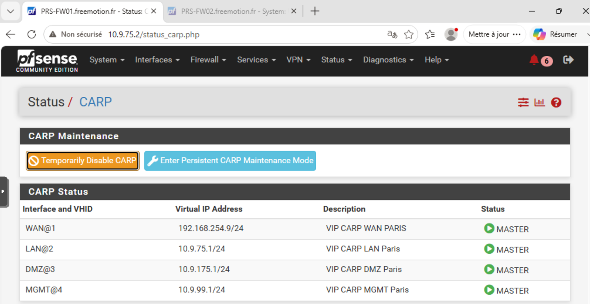
 
**PRS-FW02**
 
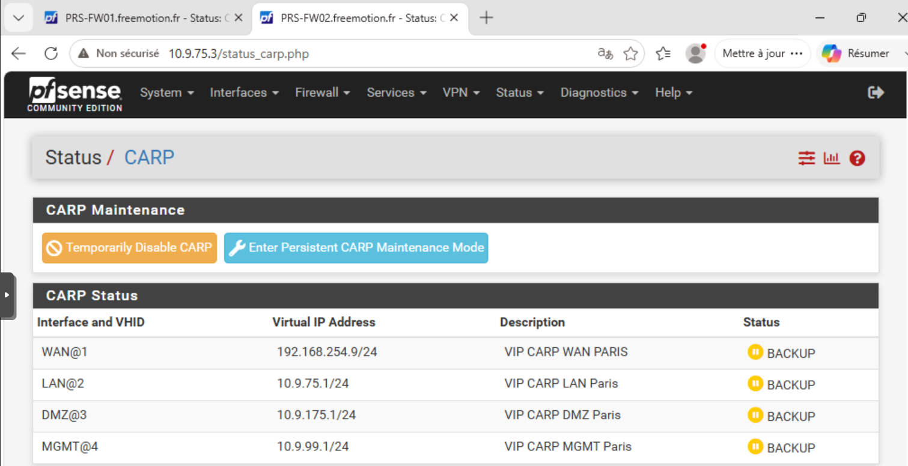
 
**LY-FW01**
 
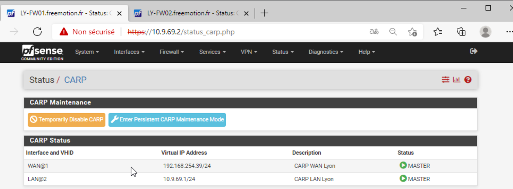
 
**LY-FW02**
 
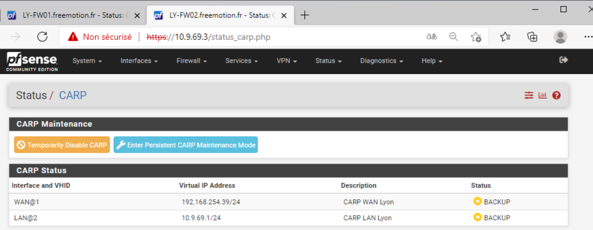
 
### Synchronisation sur une interface dédiée
 
La synchronisation passe par une interface dédiée, nommée **pfSync**. 
Chaque paire dispose de son propre sous-réseau /30 : `10.9.250.0/30` à Paris et `10.9.250.4/30` à Lyon. 
Ce trafic, isolé des interfaces de production, ne les charge pas, et l'état des deux nœuds reste vérifié de façon fiable et rapide.
 
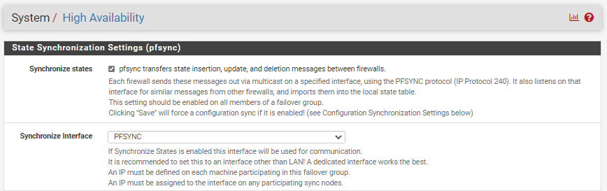
 
Une règle autorise les flux de synchronisation entre les deux nœuds du cluster :
 
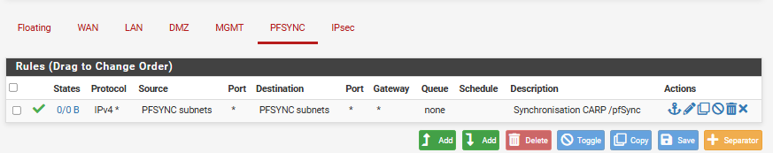
 
Cette règle n'impose volontairement aucune restriction de port ni de protocole. Le sous-réseau pfSync est un lien point à point isolé, qui ne relie que les deux nœuds du cluster. Seuls deux trafics y circulent :
 
- **pfSync** (protocole IP 240), pour la synchronisation des états ;
- **XML-RPC** (HTTPS), pour la synchronisation de la configuration.

### Tests et validation de la haute disponibilité
 
Ce test vérifie le mécanisme CARP entre **PRS-FW01** (Master) et **PRS-FW02** (Backup). Il contrôle deux points : les VIP basculent correctement, et le pare-feu secondaire prend bien le relais.
 
#### Bascule vers le pare-feu Backup
 
La bascule est déclenchée volontairement en activant le **mode maintenance persistant** sur le pare-feu Master. Ce mode abaisse sa priorité CARP, ce qui force son partenaire à devenir Master sans avoir à simuler une panne.
 
Une fois le mode activé, les statuts changent :
 
- **PRS-FW01** passe en **BACKUP** ;

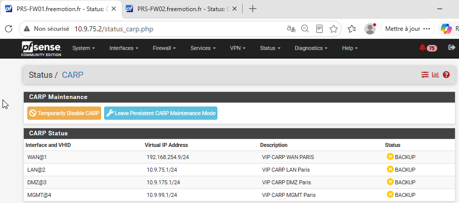
 
- **PRS-FW02** passe en **MASTER** et reprend l'ensemble des VIP.
 
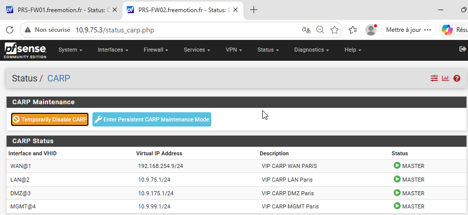
 
#### Vérification dans les journaux
 
Les journaux système des deux pare-feux enregistrent les transitions d'état CARP (`CARP state`). Ils confirment que la bascule a touché toutes les interfaces concernées, et pas seulement une partie d'entre elles.
 
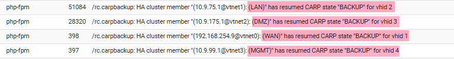
 
#### Continuité du trafic
 
Un `ping` continu tourne pendant toute la bascule, d'un poste du LAN vers la passerelle VIP. Il ne perd aucun paquet : la reprise de la VIP est transparente pour les postes.
 
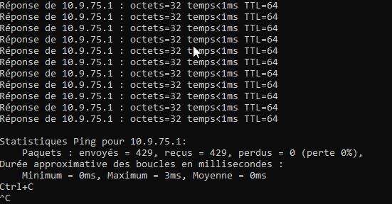 

 
#### Retour à l'état nominal

Le mode maintenance est ensuite désactivé sur PRS-FW01. Celui-ci retrouve sa priorité initiale et reprend le rôle de **MASTER**, tandis que PRS-FW02 repasse en **BACKUP**. La bascule inverse fonctionne donc également, et l'architecture revient à son état d'origine.

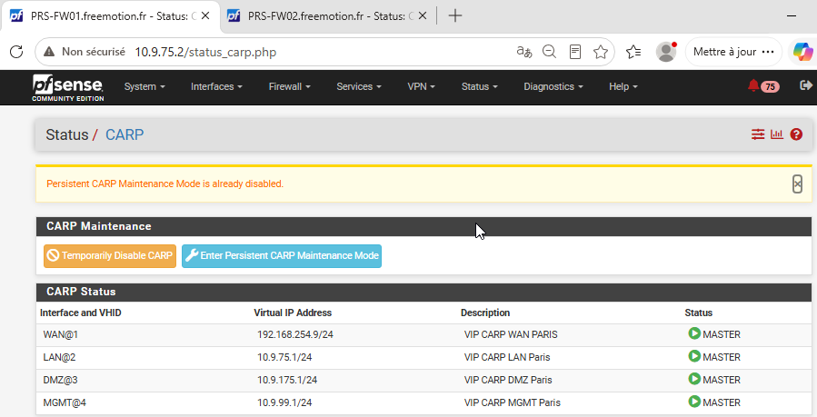
 
#### Bilan
 
La bascule fonctionne dans les deux sens, sans intervention manuelle et sans perte de paquet côté postes. La défaillance d'un pare-feu n'interrompt donc ni le filtrage ni le routage du site.

---
 
## Interconnexion VPN IPsec
 
Un tunnel IPsec chiffré relie les pfSense des deux sites. Le protocole IKEv2 a été retenu pour sa robustesse et sa compatibilité avec les méthodes d'authentification modernes.
 
Comme chaque site est en haute disponibilité, le tunnel est établi entre les **VIP WAN** des deux paires, et non entre les adresses physiques. Après une bascule, le nouveau Master renégocie donc le tunnel automatiquement.
 
| Site  | IP WAN (VIP)   | Réseau local         |
|-------|----------------|----------------------|
| Paris | 192.168.254.9  | 10.9.75.0/24 (LAN)   |
| Paris | 192.168.254.9  | 10.9.99.0/24 (MGMT)  |
| Lyon  | 192.168.254.39 | 10.9.69.0/24 (LAN)   |
 
### Création de la CA et des certificats
 
L'authentification par certificats a été préférée à une clé pré-partagée (PSK) pour trois raisons :
 
- elle évite de partager un secret statique entre les sites ;
- elle permet de révoquer individuellement le certificat d'un pare-feu compromis ;
- elle suit les recommandations de l'ANSSI pour les liaisons site à site.

Une autorité de certification (CA) dédiée au VPN, `Freemotion-CA-VPN`, est créée sur le pare-feu de Paris. Elle émet les certificats d'authentification des deux sites.
 
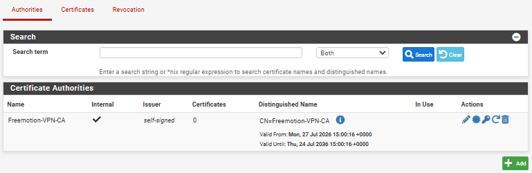
 
Un certificat signé par cette CA est ensuite généré pour chaque site. Chaque pare-feu dispose ainsi de sa propre identité cryptographique.
 
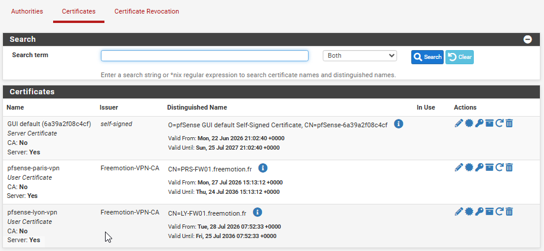
 
Enfin, deux éléments sont exportés depuis Paris puis importés sur le cluster de Lyon :
 
- le certificat de la CA, qui permet à chaque site de valider le certificat présenté par l'autre ;
- le certificat de Lyon **avec sa clé privée**, qui permet à Lyon de prouver son identité.

C'est ce qui rend possible l'authentification mutuelle d'IKEv2.
 
### Création du tunnel inter-site
 
Une **phase 1** (IKEv2) est créée entre les VIP WAN des deux sites. Ses paramètres sont strictement identiques des deux côtés, sans quoi la négociation échoue.
 
<!-- À VÉRIFIER dans pfSense : SHA-512 et DPD 10 s (valeurs reprises du tableau de risques du rapport). -->
 
| Paramètre             | Valeur | Justification |
|-----------------------|--------|---|
| Version               | IKEv2 | Négociation plus robuste et plus rapide qu'IKEv1 |
| Authentification      | Certificats (`Freemotion-CA-VPN`) | Pas de secret statique partagé, révocation possible site par site |
| Chiffrement           | AES-256-GCM | Chiffrement authentifié, recommandé par l'ANSSI |
| Intégrité / PRF       | SHA-512 | Fonction de hachage robuste |
| Groupe Diffie-Hellman | 14 (2048 bits) | Échange de clés de niveau suffisant |
| Dead Peer Detection   | 10 s | Perte du pair détectée rapidement, utile lors d'une bascule CARP |
 
Deux **phases 2** (ESP, AES-256-GCM, PFS groupe 14) définissent ensuite les réseaux autorisés à traverser le tunnel :
 
| Phase 2         | Réseau Paris   | Réseau Lyon    | Usage |
|-----------------|----------------|----------------|-------|
| `VPN-Lyon-LAN`  | `10.9.75.0/24` | `10.9.69.0/24` | Accès de Lyon aux contrôleurs de domaine et aux services métiers de Paris |
| `VPN-Lyon-MGMT` | `10.9.99.0/24` | `10.9.69.0/24` | Supervision des machines et des pare-feux de Lyon par Zabbix et Wazuh |
 
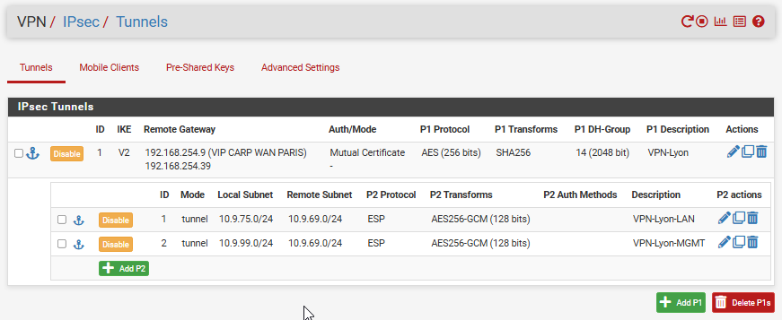
 
### Règles de pare-feu
 
#### Interface WAN
 
Par défaut, pfSense bloque le trafic qui arrive sur l'interface WAN. Pour que le tunnel puisse s'établir, des règles explicites autorisent les flux de négociation et de transport IPsec :
 
| Règle  | Protocole | Port | Rôle |
|--------|-----------|------|---|
| ESP    | ESP       | -    | Transport des données chiffrées du tunnel |
| IKE    | UDP       | 500  | Négociation IKEv2 et échange des clés |
| NAT-T  | UDP       | 4500 | Encapsulation IPsec lorsqu'un équipement NAT se trouve sur le chemin |
 
Ces règles n'acceptent que l'adresse WAN du site pair : aucune autre adresse ne peut ouvrir de négociation.
 
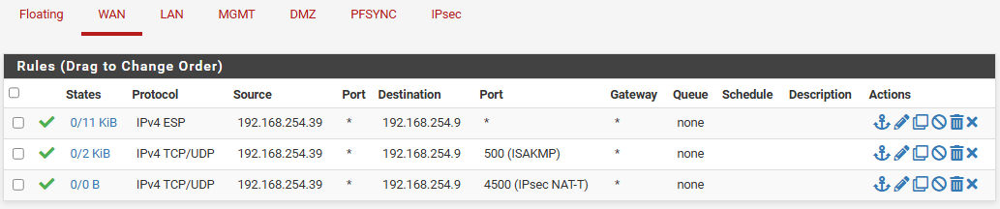
 
#### Interface IPsec
 
Une fois le tunnel établi, le trafic qui y circule est filtré par les règles de l'interface **IPsec**, distinctes de celles du WAN. Ces règles appliquent le moindre privilège à l'intérieur même du tunnel : plutôt qu'une règle « any » entre les sites, seuls les flux nécessaires sont ouverts. Ils sont regroupés dans deux alias.
 
**Flux Active Directory** (`AD_Ports_Freemotion`), limités aux contrôleurs de Paris et au RODC de Lyon :
 
| Port | Protocole | Service |
|---|---|---|
| 53 | TCP/UDP | DNS |
| 88 | TCP/UDP | Kerberos |
| 123 | UDP | NTP |
| 135 | TCP | RPC Endpoint Mapper |
| 389 | TCP/UDP | LDAP |
| 445 | TCP | SMB (réplication SYSVOL) |
| 636 | TCP | LDAPS |
| 49152-65535 | TCP | RPC dynamique (réplication AD) |
 
**Flux de supervision** (`Supervision_Freemotion`), uniquement du LAN de Lyon vers le réseau Management de Paris :
 
| Port | Protocole | Service |
|---|---|---|
| 10050 | TCP | Zabbix Agent (mode passif) |
| 10051 | TCP | Zabbix Trapper (mode actif) |
| 1514 | TCP | Wazuh Agent |
| 1515 | TCP | Wazuh Enrollment |
 
Le réseau Management est normalement isolé. L'ouvrir depuis Lyon est donc une exception, justifiée par le besoin de superviser tout le SI depuis un point unique. Cette exception est strictement encadrée :
 
- seuls les flux techniques des agents vers les serveurs sont autorisés ;
- aucune interface d'administration (Zabbix, Wazuh) n'est accessible depuis Lyon ;
- le flux ne circule que dans le tunnel chiffré et authentifié par certificat.
<!-- [IMAGE] Règles de l'interface IPsec avec les alias AD_Ports_Freemotion et Supervision_Freemotion (../images/reseau/14b-Configuration-Regles-IPsec.png) - figures 23 et 31 du rapport -->
 
### Tests et validation du tunnel VPN inter-site
 
Ces tests vérifient trois choses : le tunnel s'établit, chaque phase 2 laisse passer exactement les réseaux prévus, et la liaison résiste à la perte d'un pare-feu.
 
#### État du tunnel
 
L'état du tunnel se consulte dans **Status > IPsec > Overview**. Les deux phases de la négociation y apparaissent comme établies :
 
- **Phase 1 (IKE)** : les deux pare-feux se sont authentifiés mutuellement et ont échangé leurs clés ;
- **Phase 2 (IPsec / Child SA)** : un canal chiffré est créé pour chacun des deux couples de réseaux.
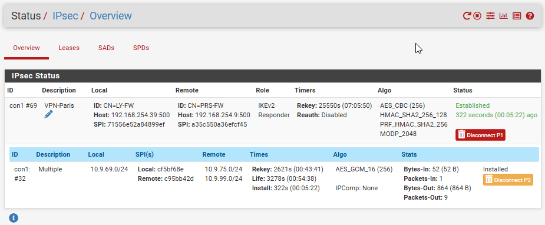
 
#### Connectivité inter-site
 
Les pings sont lancés depuis **Diagnostics > Ping**, avec comme source l'adresse de l'interface interne concernée. Le trafic correspond alors au sélecteur de la phase 2 et emprunte le tunnel : un ping émis depuis l'adresse WAN, lui, ne passerait pas dans le tunnel.
 
Ping du LAN de Paris (PRS-FW01) vers la VIP du LAN de Lyon :
 
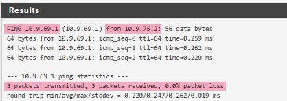
 
Ping du LAN de Lyon (LY-FW01) vers la VIP du réseau Management de Paris. La règle ICMP utilisée pour ce test a été désactivée après la validation :
 
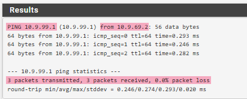
 
#### Résilience du tunnel lors d'une bascule CARP
 
Le tunnel étant établi entre les VIP WAN, il doit survivre à la perte d'un pare-feu. Le mode maintenance persistant est activé sur `PRS-FW01` : `PRS-FW02` devient MASTER et reprend la VIP WAN. 
Sur le nouveau Master, le tunnel est renégocié automatiquement, sans intervention.

Les pings LAN-LAN et LAN Lyon → MGMT répondent de nouveau : 

**Ping LAN Paris → LAN Lyon**

**Ping LAN Lyon → MGMT**

À la sortie du mode maintenance, `PRS-FW01` reprend son rôle et le tunnel se rétablit de la même façon.

#### Bilan
 
Les deux phases 2 laissent passer exactement les réseaux prévus, et le tunnel se renégocie seul après la perte d'un pare-feu. La liaison entre les sites ne constitue donc pas un point de défaillance unique.
 
---
 
## Détection d'intrusion Suricata
 
Suricata est déployé sur les quatre pare-feux de Paris et de Lyon. Comme la synchronisation XML-RPC ne réplique pas ce package, il est installé et configuré sur chaque nœud de la paire HA. En fonctionnement normal, seul le nœud MASTER inspecte le trafic. Après chaque bascule, il faut donc vérifier que Suricata tourne bien sur le nouveau Master, pour ne pas laisser de trou dans la protection.
 
### Modes de fonctionnement
 
Suricata fonctionne selon deux modes distincts, appliqués différemment selon l'interface :

- **Legacy (IDS)** : Suricata observe une copie du trafic et génère des alertes, sans intervenir sur les paquets. Ce mode est passif tant que le blocage des « offenders » n'est pas activé : une attaque est détectée mais pas empêchée.
- **Inline (IPS)** : le trafic est forcé de traverser le moteur Suricata avant d'être routé, via la fonctionnalité `netmap` de pfSense. Suricata peut alors rejeter un paquet en temps réel.

Modes choisis :
- **WAN - Inline (IPS)** : le trafic entrant, externe et moins prévisible, se prête à un blocage actif une fois le tuning des faux positifs réalisé.
- **LAN & DMZ - Legacy (IDS)** : un blocage erroné pourrait interrompre un flux métier. L'inspection reste donc passive, pour garder la visibilité sans risquer de couper un service.
 
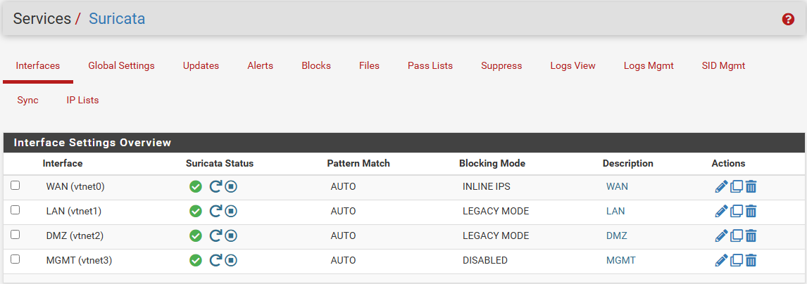
 
### Sources de signatures
 
Trois sources complémentaires sont activées, avec une mise à jour automatique chaque jour à 3 h :
 
- **ETOpen** (Emerging Threats Open) : socle communautaire de signatures génériques (scans, exploits connus, trafic anormal) ;
- **Snort Community Ruleset** (Talos, GPLv2) : signatures reconnues pour leur fiabilité ;
- **Feodo Tracker** : liste des serveurs de commande et de contrôle des botnets Dridex et Emotet, pour couper la communication entre un poste compromis et son infrastructure de pilotage.
### Catégories par interface
 
Les catégories de signatures sont choisies séparément pour chaque interface, selon le trafic qui peut réellement y passer :
 
| Interface | Catégories activées | Logique |
|---|---|---|
| WAN | attack_response, botcc, ciarmy, compromised, dshield, coinminer, current_events, dos, exploit, malware, mobile_malware, phishing, scan, shellcode, worm, web_client, web_server | Couverture la plus large, le WAN étant exposé |
| LAN | attack_response, botcc, ciarmy, compromised, dshield, coinminer, current_events, exploit, malware, phishing, scan, web_client, worm | Détection d'une compromission interne et d'un mouvement latéral ; `web_server` est désactivée, aucun service web n'étant hébergé sur le LAN |
| DMZ | web_server, web_client, exploit, shellcode, scan, malware, botcc, ciarmy, compromised, dshield, current_events, coinminer, worm | Attaques contre le service exposé et tentative de rebond depuis la DMZ |
| MGMT | scan, malware, botcc, ciarmy, compromised, dshield, attack_response, current_events | Réseau sans flux Internet entrant : les catégories web et exploit n'y sont pas pertinentes |
 
### Réduction des faux positifs
 
Le blocage n'a été activé qu'après au moins une semaine d'observation en simple détection. Cette période couvrait les sauvegardes nocturnes, la synchronisation pfSync et la réplication AD. Les alertes récurrentes ont ensuite été triées par SID et par fréquence :
 
- une signature qui se déclenche sur du trafic légitime est neutralisée de façon ciblée dans la **Suppress List** (couple IP + SID), plutôt qu'en désactivant toute sa catégorie ;
- les flux de confiance (tunnel IPsec, réplication AD, pfSync, supervision, ingestion Wazuh) sont placés en **Pass List**.
Les alertes sont réévaluées après chaque mise à jour majeure des signatures.
 
<!-- [VALIDATION À AJOUTER si le test est réalisé] Scan nmap depuis l'extérieur vers la VIP WAN de Paris → alertes de catégorie scan dans Services > Suricata > WAN > Alerts, adresse source visible dans l'onglet Blocks (../images/reseau/18b-Test-Suricata.png). -->
 
---
 
## Filtrage pfBlockerNG
 
pfBlockerNG-devel est le second mécanisme de défense périmétrique, complémentaire de Suricata. Là où Suricata inspecte le **contenu** du trafic, pfBlockerNG filtre en amont selon deux critères simples et peu coûteux en ressources :
 
- **l'origine géographique** de l'adresse source (listes GeoIP) ;
- **la réputation du domaine** interrogé en DNS (listes DNSBL).

Ce filtrage réduit le bruit et le nombre d'alertes générées par le trafic en provenance de zones sans lien avec l'activité de l'entreprise, ce qui facilite l'exploitation des alertes Suricata.
 
### Politique de blocage géographique
 
Plutôt qu'un blocage par continent complet (trop large : l'Europe inclut par exemple la Russie), la politique retenue s'appuie sur une **sélection de pays au sein de chaque continent GeoIP** :

- **Europe** : bloquée, à l'exception des 27 pays membres de l'Union européenne.
- **Amérique du Nord** : bloquée, à l'exception des États-Unis et du Canada.
- **Autres continents** (Afrique, Antarctique, Asie, Océanie, Amérique du Sud) : bloqués intégralement.

Les pays exclus de ces sélections (UE, États-Unis, Canada) ne sont soumis à aucune règle de blocage GeoIP et restent donc autorisés.

Ces exceptions répondent à des besoins métier précis : **l'Union européenne** est autorisée car elle correspond à la zone d'activité de Freemotion, et les **États-Unis** le sont pour permettre l'accès aux services cloud de Microsoft (OneDrive, etc.), hébergés en grande partie sur leur infrastructure. {/* [À VÉRIFIER] Justification du Canada + sens du filtrage (entrant / sortant) sur lequel s'applique le GeoIP. */}

 
### Flux DNSBL
 
En complément du blocage par adresse IP, le module **DNSBL** (*DNS Black List*) agit lors de la résolution DNS, et non au niveau du paquet IP. Une requête vers un domaine référencé comme malveillant (phishing, C2, publicité malveillante) est interceptée et redirigée vers une page de blocage locale. La connexion n'a donc même pas le temps de s'établir.
 
Ce filtrage ne fonctionne que si les requêtes des postes arrivent au résolveur de pfSense (Unbound). C'est le cas grâce à la chaîne DNS du domaine :
 
1. les postes interrogent les contrôleurs de domaine ;
2. les contrôleurs résolvent eux-mêmes la zone `freemotion.fr` ;
3. ils redirigent les requêtes externes vers pfSense, qui autorise leur adresse dans **Services > DNS Resolver > Access Lists**.
Le DNSBL filtre ainsi les requêtes des postes sans perturber l'Active Directory (voir [Annuaire](./2-annuaire.md)).
 
Les feeds retenus sont les suivants :
 
- **EasyList / EasyPrivacy** : publicité et traqueurs ;
- **URLhaus** : domaines qui hébergent activement des malwares, en cohérence avec Feodo Tracker côté Suricata ;
- **Phishing Army** : domaines de phishing actifs.
  

 
Pour vérifier le fonctionnement, on résout, depuis un poste du domaine, un domaine de test référencé dans un feed. La réponse renvoie l'adresse de la page de blocage locale de pfBlockerNG au lieu de l'adresse réelle : toute la chaîne fonctionne, du poste au DNSBL en passant par le contrôleur de domaine et Unbound.
 
<!-- [IMAGE] nslookup d'un domaine listé depuis un poste → IP de la page de blocage (../images/reseau/22-Test-DNSBL.png) -->
 
---
 
## Conclusion
 
Le périmètre de Freemotion repose sur une défense en couches, sans point de défaillance unique au niveau du filtrage :
 
- **Haute disponibilité** : chaque site dispose de sa paire pfSense en CARP, synchronisée par pfSync et XML-RPC sur un lien dédié. La bascule a été validée dans les deux sens, sans perte de paquet.

- **Interconnexion** : les sites sont reliés par un tunnel IPsec IKEv2 authentifié par certificats. Ses deux phases 2 et ses règles par alias limitent les échanges aux flux Active Directory et de supervision, et le tunnel survit à la perte d'un pare-feu.
  
- **Inspection et filtrage** : Suricata inspecte le trafic avec un mode et des catégories adaptés à chaque interface. En amont, pfBlockerNG écarte le trafic issu de zones sans lien avec l'activité de l'entreprise, ainsi que les domaines malveillants.
Deux points restent à surveiller en exploitation : vérifier que Suricata tourne bien sur le nouveau Master après chaque bascule, et réévaluer les faux positifs après chaque mise à jour des signatures.
 
---
 
[← Architecture](./0-architecture.md) · [Sommaire](../README.md) · [Annuaire →](./2-annuaire.md)
