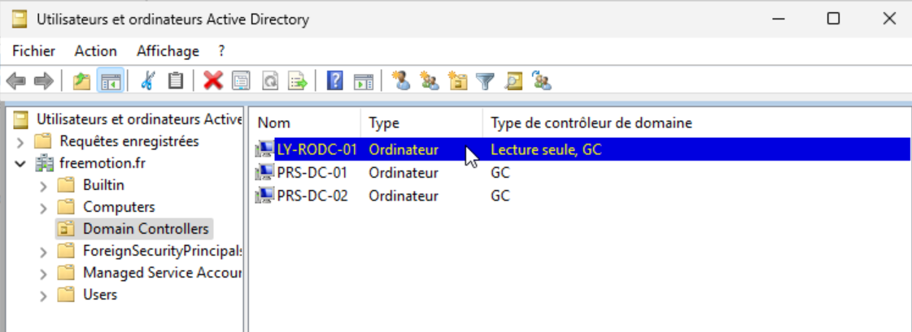
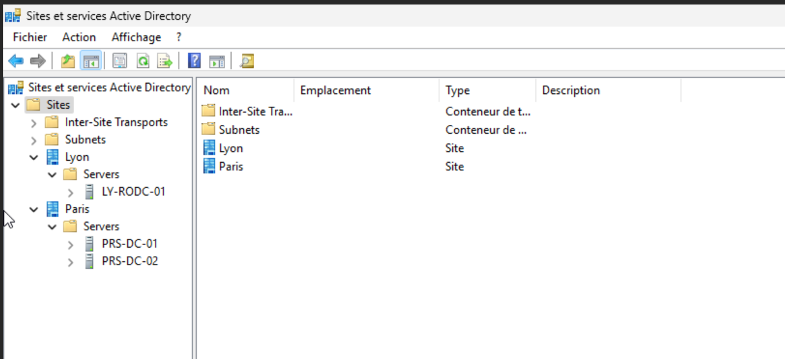
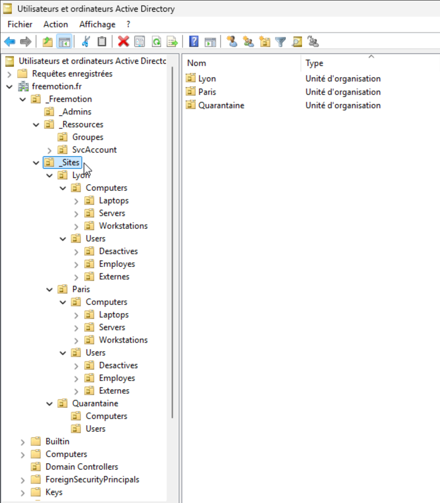
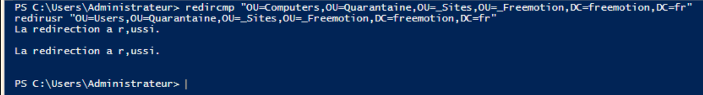
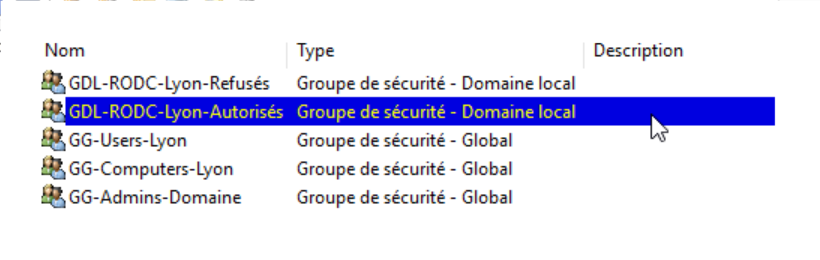
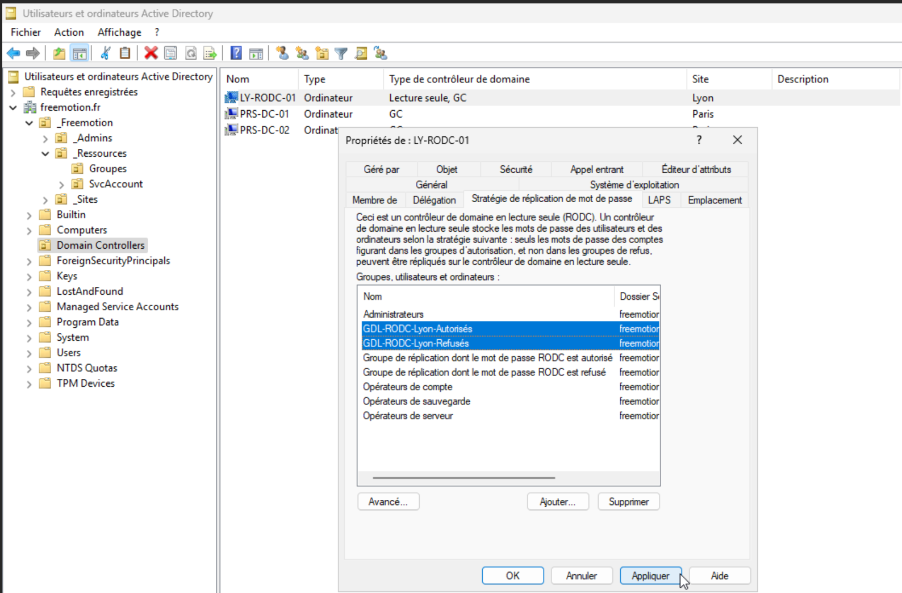
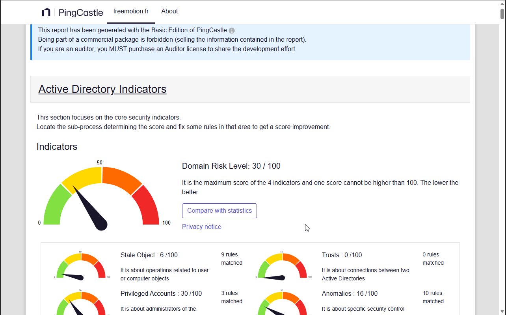

# Active Directory : architecture multisite et sécurisation

[← Retour au projet](../README.md)

[← Réseau](./0-architecture.md) · [Serveur de Fichiers →](./2-annuaire.md)


## Introduction

L'identité du système d'information de **Freemotion** repose sur un annuaire **Active Directory Domain Services (AD DS)** multisite. Il centralise la gestion des comptes, des ressources et des politiques de sécurité, et sert de socle aux autres services de l'infrastructure, notamment le [serveur de fichiers](3-serveur-fichiers.md) et les [bureaux à distance](4-rds.md).

L'architecture retenue comprend trois contrôleurs de domaine :

- deux **contrôleurs de domaine (DC)** inscriptibles à **Paris** ;
- un **contrôleur de domaine en lecture seule (RODC)** à **Lyon**.

Cette organisation permet :

- d'assurer la **haute disponibilité** de l'annuaire sur le site principal ;
- d'optimiser les **performances d'authentification** du site distant ;
- de limiter les **risques de compromission** sur un site sans sécurité physique fiable.

---

## Mise en place des contrôleurs de domaine

### Architecture

| Propriété          | Valeur              |
|--------------------|---------------------|
| Domaine / forêt    | `freemotion.fr`     |
| Niveau fonctionnel | Windows Server 2025 |
| Site principal     | Paris               |
| Site distant       | Lyon                |

| Serveur         | Site  | Adresse IP     | Rôle                                          |
|-----------------|-------|----------------|-----------------------------------------------|
| **PRS-DC-01**   | Paris | `10.9.75.10`   | Contrôleur de domaine principal + rôles FSMO  |
| **PRS-DC-02**   | Paris | `10.9.75.11`   | Contrôleur de domaine secondaire (redondance) |
| **LY-RODC-01**  | Lyon  | `10.9.69.10`   | Contrôleur de domaine en lecture seule        |

Les rôles **AD DS** et **DNS** sont installés sur chacun d'eux. Les postes utilisent les DC comme serveurs DNS primaires, et ces derniers redirigent les requêtes externes vers le DNS Resolver de pfSense.

L'adressage des postes est assuré par un service **DHCP centralisé** à Paris. Les requêtes des postes lyonnais lui parviennent par un **relais DHCP** à travers le tunnel inter-site, ce qui évite de maintenir un second serveur DHCP sur le site distant.

Les deux sites communiquent par le **tunnel VPN IPsec IKEv2** décrit dans la page [Réseau et sécurité périmétrique](1-reseau.md). Ce tunnel porte la réplication Active Directory, dont les flux (DNS, Kerberos, LDAP, RPC, SMB pour SYSVOL) sont regroupés dans l'alias pfSense `AD_Ports_Freemotion` et limités aux DC de Paris et au RODC de Lyon.

### Pourquoi un RODC à Lyon ?

Le site de Lyon ne dispose d'aucune sécurité physique fiable. Un **RODC** (*Read-Only Domain Controller*) ne stocke pas l'intégralité de l'annuaire et ne met en cache que les mots de passe explicitement autorisés. En cas de compromission physique, l'exposition est limitée aux seuls comptes lyonnais, tout en conservant une authentification locale. 

### Promotion

- **PRS-DC-01** est promu en premier contrôleur de domaine : il crée la forêt et le domaine `freemotion.fr` et porte les rôles FSMO. Les dossiers **NTDS** et **SYSVOL** sont placés sur un volume dédié `S:\`, séparé du système, pour améliorer les performances, faciliter les sauvegardes et éviter qu'une saturation du disque système n'affecte l'annuaire.
- **PRS-DC-02** est promu en contrôleur additionnel et réplique l'annuaire depuis `PRS-DC-01`.
- **LY-RODC-01** rejoint d'abord le domaine, puis est promu en RODC et rattaché au site de Lyon.



---

## Sites et Services Active Directory

La réplication garantit la cohérence de l'annuaire sur l'ensemble des DC : toute modification (création d'un compte, changement de mot de passe, application d'une GPO) doit être propagée rapidement. Deux types de réplication sont mis en œuvre.

| Réplication            | Contrôleurs concernés                     | Fonctionnement                                                                           |
|------------------------|-------------------------------------------|------------------------------------------------------------------------------------------|
| **Intra-site (Paris)** | `PRS-DC-01` ↔ `PRS-DC-02`                 | Communication directe et continue, synchronisation quasi immédiate                       |
| **Inter-site**         | `PRS-DC-01` / `PRS-DC-02` → `LY-RODC-01`  | Unidirectionnelle vers le RODC, planifiée toutes les 15 minutes via le lien `Paris-Lyon` |

### Topologie configurée

La topologie logique reflète la topologie physique : le site par défaut est renommé `Paris`, le site `Lyon` est créé, puis chaque sous-réseau est associé à son site.

| Élément                   | Configuration                                     |
|---------------------------|---------------------------------------------------|
| Site `Paris`              | Sous-réseau `10.9.75.0/24`                        |
| Site `Lyon`               | Sous-réseau `10.9.69.0/24`                        |
| Lien de site              | `Paris-Lyon` (renommé depuis `DEFAULTIPSITELINK`) |
| Coût                      | `100` (valeur par défaut conservée)               |
| Intervalle de réplication | `15 minutes`                                      |

L'**association des sous-réseaux aux sites** est essentielle : sans elle, les machines ne sont pas rattachées automatiquement à leur site. Elles s'authentifient alors auprès d'un DC potentiellement distant, ce qui dégrade les performances et génère du trafic inter-site inutile.

Le **coût** permet à AD de choisir le chemin de réplication le plus prioritaire lorsque plusieurs liens existent : plus il est faible, plus le lien est privilégié. Un seul lien étant présent ici, la valeur par défaut est conservée. L'**intervalle de 15 minutes** limite la consommation de bande passante sur le VPN tout en gardant le RODC à jour.



---

## Structure de l'Active Directory

### Organisation des OU

La hiérarchie suit un découpage par **site géographique**, puis par **type d'objet** (ordinateurs, utilisateurs), avec une organisation interne par usage ou niveau de rôle. Des OU transverses portent l'administration, les ressources et la quarantaine.

```
freemotion.fr
├── _Freemotion
│   ├── _Admins
│   ├── _Sites
│   │   ├── Quarantaine        ← transit des nouveaux objets (Computers, Users)
│   │   ├── Paris
│   │   │   ├── Computers
│   │   │   │   ├── Workstations
│   │   │   │   ├── Laptops
│   │   │   │   └── Servers
│   │   │   │       └── Infra  ← PRS-FILE-01, PRS-RDS-01
│   │   │   └── Users
│   │   │       ├── Employes
│   │   │       ├── Externes
│   │   │       └── Desactives
│   │   └── Lyon
│   │       ├── Computers
│   │       │   ├── Workstations
│   │       │   └── Laptops
│   │       └── Users
│   │           ├── Employes
│   │           ├── Externes
│   │           └── Desactives
│   └── _Ressources
│       ├── Groupes
│       └── SvcAccounts
└── Domain Controllers
```

Toutes les OU sont regroupées sous une OU racine `_Freemotion`. Le préfixe underscore la place en tête de la console ADUC et la distingue des conteneurs système générés par Windows (`Builtin`, `Computers`, `Users`). La création de l'ensemble des OU est **automatisée par un script PowerShell** (`New-ADOrganizationalUnit`), ce qui garantit une structure reproductible et sans erreur de chemin LDAP.



### Conventions de nommage

| Objet               | Format         | Exemple        |
|---------------------|----------------|----------------|
| Employé standard    | `p.nom`        | `p.dupont`     |
| Prestataire externe | `ext.nom`      | `ext.martin`   |
| Compte de service   | `svc.service`  | `svc.backup`   |
| Compte admin        | `adm.nom`      | `adm.dupont`   |
| Poste fixe Paris    | `PRS-WS-XXXX`  | `PRS-WS-0042`  |
| Laptop Paris        | `PRS-LT-XXXX`  | `PRS-LT-0012`  |
| Serveur Paris       | `PRS-ROLE-XX`  | `PRS-FILE-01`  |
| Poste fixe Lyon     | `LY-WS-XXXX`   | `LY-WS-0001`   |
| Laptop Lyon         | `LY-LT-XXXX`   | `LY-LT-0001`   |

### Redirection des objets par défaut

Aucun objet n'est créé dans les conteneurs par défaut `Computers` et `Users`. Les commandes `redircmp` et `redirusr` redirigent automatiquement les nouveaux objets vers l'OU `Quarantaine` :

```powershell
redircmp "OU=Computers,OU=Quarantaine,OU=_Sites,OU=_Freemotion,DC=freemotion,DC=fr"
redirusr "OU=Users,OU=Quarantaine,OU=_Sites,OU=_Freemotion,DC=freemotion,DC=fr"
```

Tout nouvel ordinateur ou compte utilisateur arrive donc en quarantaine, quelle que soit sa destination, avant d'être déplacé vers son OU finale (site et type).



### Principes d'administration

- **Séparation des comptes** : un administrateur dispose d'un compte standard pour le quotidien et d'un compte dédié `adm.` pour l'administration.
- **Comptes externes** : ils disposent systématiquement d'une date d'expiration (attribut `accountExpires`).
- **Départ d'un collaborateur** : le compte est désactivé le jour du départ et déplacé dans l'OU `Desactives` du site. La suppression définitive intervient après 30 jours, sur validation RH.

---

## Stratégie de réplication des mots de passe (PRP)

Contrairement à un DC standard, le RODC ne stocke pas toute la base AD. La **Password Replication Policy (PRP)** définit précisément quels comptes peuvent avoir leur mot de passe mis en cache localement, et lesquels en sont exclus. En cas de compromission physique du RODC, seuls les mots de passe effectivement mis en cache sont exposés : les comptes sensibles, privilégiés et de service sont donc systématiquement exclus.

### Groupes (modèle AGDLP)

Les groupes sont créés sur `PRS-DC-01`.

| Groupe                    | Type         | Rôle                                                                                                                               |
|---------------------------|--------------|------------------------------------------------------------------------------------------------------------------------------------|
| `GG-Users-Lyon`           | Global       | Comptes utilisateurs du site de Lyon                                                                                               |
| `GG-Computers-Lyon`       | Global       | Comptes ordinateurs du site de Lyon                                                                                                |
| `GG-Admins-Domaine`       | Global       | Comptes administrateurs du domaine                                                                                                 |
| `GDL-RODC-Lyon-Autorisés` | Domain Local | **Autorise** la mise en cache ; contient `GG-Users-Lyon` et `GG-Computers-Lyon`                                                    |
| `GDL-RODC-Lyon-Refusés`   | Domain Local | **Refuse** la mise en cache ; contient `GG-Admins-Domaine`, les comptes de service et les comptes sensibles ou à privilèges élevés |



### Déclaration dans la PRP

Dans les propriétés de `LY-RODC-01` (onglet *Stratégie de réplication des mots de passe*), `GDL-RODC-Lyon-Autorisés` est déclaré en **autorisation** et `GDL-RODC-Lyon-Refusés` en **refus**.

Les utilisateurs lyonnais peuvent ainsi s'authentifier localement même en cas de coupure du VPN vers Paris, tandis qu'aucun identifiant privilégié n'est jamais mis en cache sur le site distant. En cas de compromission du RODC, le rayon d'impact reste limité aux utilisateurs et ordinateurs de Lyon, et les comptes sensibles hébergés à Paris sont préservés.

Cette configuration doit être maintenue à jour à chaque évolution : arrivée de nouveaux utilisateurs, création de comptes de service ou modification des périmètres d'administration.



---

## Audit avec PingCastle

La sécurité de l'annuaire est évaluée avec **PingCastle**, qui attribue au domaine `freemotion.fr` un score de risque sur une échelle de 0 à 100 : plus le score est bas, meilleur est le niveau de sécurité.

### Résultat

| Exécution                | Score de risque du domaine |
|--------------------------|----------------------------|
| 1<sup>re</sup> exécution | **60 / 100**               |
| 2<sup>e</sup> exécution  | **30 / 100**               |

Le score est divisé par deux entre les deux exécutions, ce qui traduit une amélioration notable de la sécurité du domaine.



### Point restant

Le rapport signale encore un point, qui pèse pour **+20 points** dans le score : *« The native administrator account has been used recently »*. Le compte **Administrateur intégré** du domaine a servi à une connexion six jours avant l'audit.

### Remédiation

La remédiation identifiée comporte trois mesures :

- l'**abandon** de toute connexion avec le compte natif, au profit des comptes d'administration nominatifs (`adm.nom`), conformément au principe de moindre privilège appliqué sur le reste du projet ;
- la **désactivation** du compte Administrateur intégré ou, à défaut, son **renommage** avec un mot de passe complexe non partagé ;
- à terme, la **gestion** de ce mot de passe par **Windows LAPS**.

---

## Conclusion

L'annuaire `freemotion.fr` constitue le socle d'identité de l'infrastructure. Deux contrôleurs de domaine assurent la haute disponibilité à Paris, tandis qu'un RODC permet aux utilisateurs lyonnais de s'authentifier localement sans exposer les comptes sensibles, grâce à une stratégie de réplication des mots de passe stricte. La structure d'OU, créée par script et associée à des conventions de nommage et à une OU de quarantaine, rend l'annuaire lisible et reproductible. Le modèle AGDLP mis en place ici est d'ailleurs réutilisé pour les droits du serveur de fichiers.

L'audit PingCastle, dont le score est passé de 60 à 30, confirme le durcissement du domaine. Le point restant, lié à l'usage du compte Administrateur intégré, fait l'objet d'une remédiation identifiée. À terme, le déploiement de Windows LAPS et la mise en place d'un modèle d'administration par tiers permettraient de poursuivre cette démarche.

---

[← Réseau](1-reseau.md) · [Sommaire](../README.md) · [Serveur de fichiers →](3-serveur-fichiers.md)
