# Serveur de fichiers : partages, redirection et FSRM

[← Retour au projet](../README.md)

[← Annuaire](2-annuaire.md) · [RDS →](4-rds.md)

## Introduction

Le serveur de fichiers **PRS-FILE-01** (`10.9.75.20`) héberge les données communes à plusieurs utilisateurs et à plusieurs services. Il repose sur trois briques complémentaires :

- les **partages de service** (RH, Commercial, Direction), dont les droits suivent le modèle **AGDLP** ;
- la **redirection des dossiers** Documents et Bureau des utilisateurs itinérants ;
- le rôle **FSRM** (*File Server Resource Manager*) : quotas, filtrage, classification et audit.

---

## Partages et arborescence

### Arborescence

Tous les dossiers métier sont regroupés sous un dossier racine unique, situé sur le volume `D:` et publié par un seul partage réseau `\\PRS-FILE-01\Dossier_Partage_Service`.

```
PRS-FILE-01
└── D:\Dossier_Partage_Service
    ├── RH
    ├── Commercial
    └── Direction
```

Bien que regroupés physiquement, les dossiers de service restent des points de permissions NTFS distincts.

### Modèle AGDLP

Les droits suivent le modèle **AGDLP** (*Account → Global Group → Domain Local Group → Permission*), déjà appliqué à la [stratégie de réplication des mots de passe du RODC](2-annuaire.md) :

- les **comptes** sont placés dans des **groupes globaux (GG)** qui reflètent l'appartenance métier ;
- les GG sont imbriqués dans des **groupes locaux de domaine (GDL)**, un par dossier et par niveau de droit ;
- les **permissions NTFS** sont attribuées **uniquement aux GDL**, jamais aux GG ni aux comptes.

Cette séparation dissocie la gestion des appartenances (GG) de celle des droits sur les ressources (GDL), ce qui facilite la délégation et l'audit.

| Groupe global (GG)         | Contenu                                  |
|----------------------------|------------------------------------------|
| `GG_RH_RW`                 | Utilisateurs du service RH               |
| `GG_Commercial_RW`         | Utilisateurs du service Commercial       |
| `GG_Direction_RW`          | Utilisateurs du service Direction        |
| `GG_Externe_RH_RO`         | Externes en lecture seule sur RH         |
| `GG_Externe_Commercial_RO` | Externes en lecture seule sur Commercial |
| `GG_Externe_Direction_RO`  | Externes en lecture seule sur Direction  |

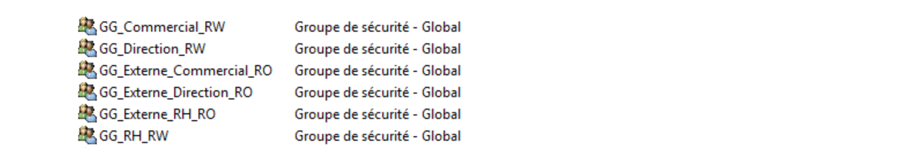

| Groupe local de domaine (GDL) | Dossier ciblé | Droit NTFS    | Membre (GG)                |
|-------------------------------|---------------|---------------|----------------------------|
| `GDL_Partage_RH_RW`           | `RH`          | Modification  | `GG_RH_RW`                 |
| `GDL_Partage_RH_RO`           | `RH`          | Lecture seule | `GG_Externe_RH_RO`         |
| `GDL_Partage_Commercial_RW`   | `Commercial`  | Modification  | `GG_Commercial_RW`         |
| `GDL_Partage_Commercial_RO`   | `Commercial`  | Lecture seule | `GG_Externe_Commercial_RO` |
| `GDL_Partage_Direction_RW`    | `Direction`   | Modification  | `GG_Direction_RW`          |
| `GDL_Partage_Direction_RO`    | `Direction`   | Lecture seule | `GG_Externe_Direction_RO`  |

Chaque dossier dispose de deux GDL distincts : l'un en modification pour le personnel du service, l'autre en lecture seule pour les externes. Cette séparation évite d'accorder par erreur des droits d'écriture à un groupe destiné à la simple consultation.


### Permissions SMB et NTFS

Deux couches de permissions se cumulent, le droit effectif étant toujours **le plus restrictif des deux**. La restriction fine est portée uniquement par NTFS :

| Niveau               | Cible                           | Groupe                      | Droit                                |
|----------------------|---------------------------------|-----------------------------|--------------------------------------|
| Partage (SMB)        | `Dossier_Partage_Service`       | `Utilisateurs authentifiés` | Contrôle total                       |
| NTFS (racine)        | `Dossier_Partage_Service`       | `Utilisateurs authentifiés` | Lecture seule (traversée du dossier) |
| NTFS (sous-dossiers) | `RH`, `Commercial`, `Direction` | `GDL_..._RW` / `GDL_..._RO` | Modification / Lecture et exécution  |

- Le partage SMB est ouvert en contrôle total afin de ne jamais plafonner les groupes RW en dessous de leur droit NTFS.
- Les utilisateurs peuvent **traverser** le dossier racine, sans accéder au contenu des sous-dossiers qui ne les concernent pas.
- Les droits sont hérités (`(OI)(CI)`) par tous les sous-dossiers et fichiers créés ultérieurement.

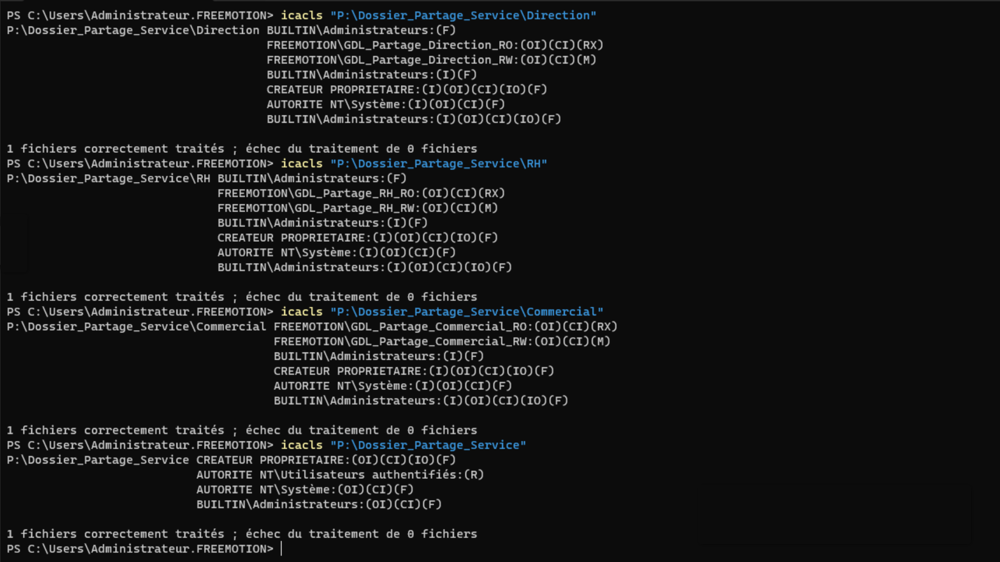

### Tests de validation

Pour chaque service, un compte `_RW` est testé en lecture et en écriture, un compte `_RO` en consultation seule, et un compte hors groupe métier pour vérifier qu'il traverse la racine sans accéder aux sous-dossiers. L'onglet **Accès effectif** complète ces tests en identifiant la couche responsable d'un refus (partage ou NTFS).

| Profil testé              | Résultat attendu et constaté                                            |
|---------------------------|-------------------------------------------------------------------------|
| Utilisateur RH (`_RW`)    | Accès en modification au dossier `RH` uniquement                        |
| Même utilisateur          | Accès refusé aux autres dossiers de service                             |
| Externe (`_RO`)           | Lecture du dossier `RH`, création de fichier impossible                 |
| Compte hors groupe métier | Traversée de la racine possible, contenu des sous-dossiers inaccessible |

**Accès en écriture avec un compte RH**

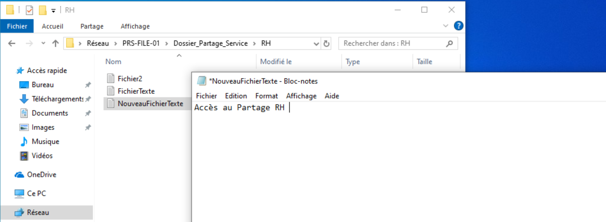

**Accès refusé à un autre dossier de service avec le même compte RH**

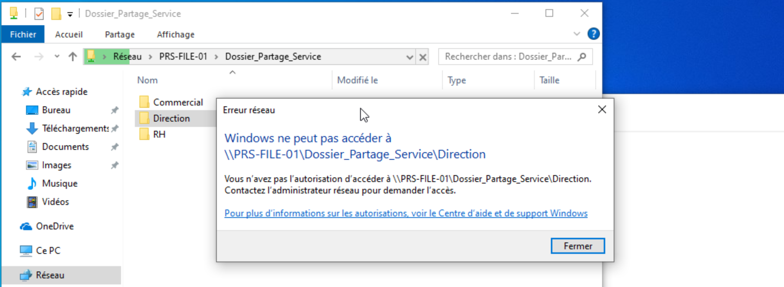

**Accès en lecture seule avec un compte externe : la création d'un fichier est refusée**

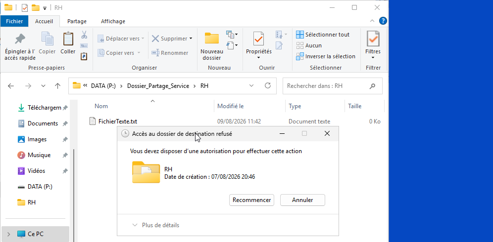

---

## Redirection de dossiers (itinérance)

Les collaborateurs itinérants se connectent indifféremment sur les postes de Paris ou de Lyon. Pour qu'ils retrouvent leurs fichiers à l'identique quel que soit le poste, les dossiers **Documents** et **Bureau** de leur profil sont redirigés vers le serveur de fichiers. L'activation des **fichiers hors connexion** garantit l'accès aux données en cas de coupure réseau ou de déplacement hors site.

### Groupes et partages

Le modèle AGDLP est réutilisé. Un groupe global `GG-Itinerants-<Site>` regroupe les utilisateurs concernés sans porter aucune permission. Il est le seul membre d'un groupe local de domaine `GDL-Redir-Doc-Bureau-<Site>`, qui reçoit les permissions NTFS et sert de filtre de sécurité à la GPO.

| Site  | Serveur       | Partage          | Groupe local de domaine      |
|-------|---------------|------------------|------------------------------|
| Paris | `PRS-FILE-01` | `Profils-Paris$` | `GDL-Redir-Doc-Bureau-Paris` |
| Lyon  | `PRS-FILE-01` | `Profils-Lyon$`  | `GDL-Redir-Doc-Bureau-Lyon`  |

Sur chaque partage, l'héritage est désactivé et les permissions sont explicites : les GDL disposent uniquement de *Créer des dossiers / ajouter des données* et de *Lire les attributs* (ce dossier seulement). Chaque utilisateur ne peut ainsi créer que son propre dossier de profil.

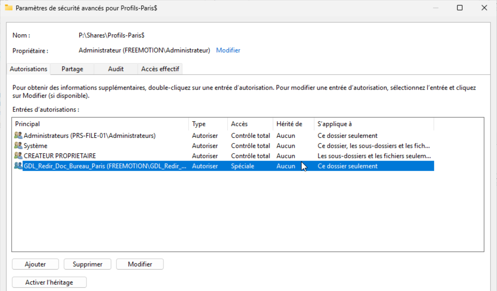

### GPO de redirection

Une seule GPO, `Redirection_Bureau_Documents`, gère les deux sites en dirigeant chaque groupe vers le partage de son propre site grâce à la redirection **avancée**. Elle est liée au conteneur `_Sites`, qui regroupe les OU Paris et Lyon.

**Filtrage de sécurité** : il est restreint aux deux groupes `GDL-Redir-Doc-Bureau-<Site>` (*Utilisateurs authentifiés* retiré), ce qui limite l'application aux seuls itinérants.

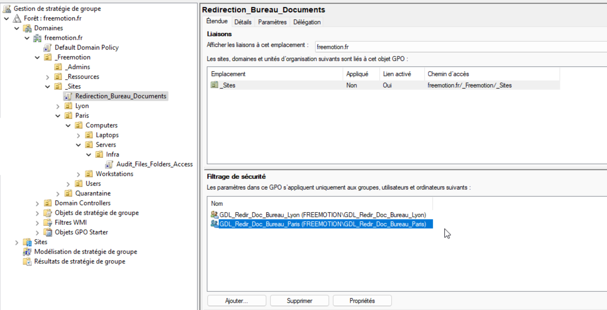

**Délégation** : *Utilisateurs authentifiés* conserve le droit de lecture, nécessaire à l'évaluation de la GPO, sans que son application soit étendue à tout le domaine.

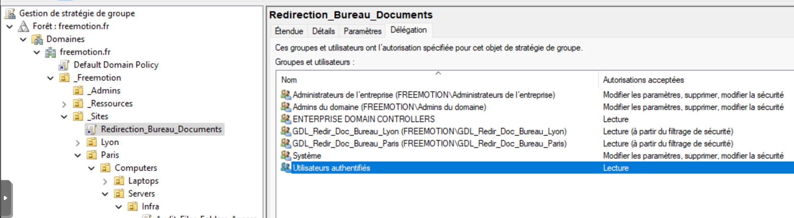

**Redirection** : Documents et Bureau sont redirigés vers `\\PRS-FILE-01\Profils-Paris$` ou `\\PRS-FILE-01\Profils-Lyon$`, avec un dossier créé par utilisateur sous le chemin racine.

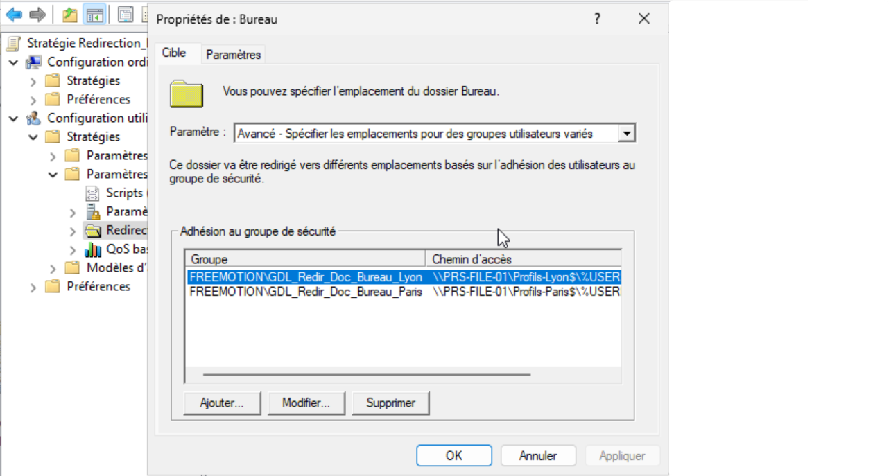

**Test** : après `gpupdate /force` et réouverture de session, les fichiers de Documents et du Bureau sont conservés mais désormais stockés sur le partage du site. L'emplacement réel du dossier et l'icône de synchronisation hors connexion le confirment.

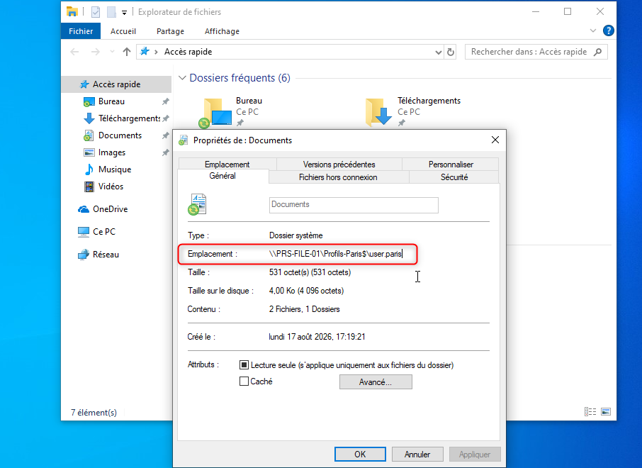

---

## Gestion des données avec FSRM

Le rôle **FSRM** répond à quatre besoins : limiter l'espace consommé, bloquer les fichiers non désirés, identifier les documents sensibles et tracer les accès.

### Quotas

Chaque dossier de service dispose d'un quota **inconditionnel de 1 Go** : la limite est stricte, et toute écriture est bloquée une fois le quota atteint. Un quota conditionnel se contenterait d'alerter l'administrateur.

Le modèle par défaut « Limite de 2 Go » est modifié et renommé plutôt que de créer un modèle dédié. Le quota est appliqué à la racine des services avec l'option **Appliquer automatiquement le modèle et créer des quotas sur les sous-dossiers existants et nouveaux**, ce qui couvre aussi les futurs services sans configuration manuelle.

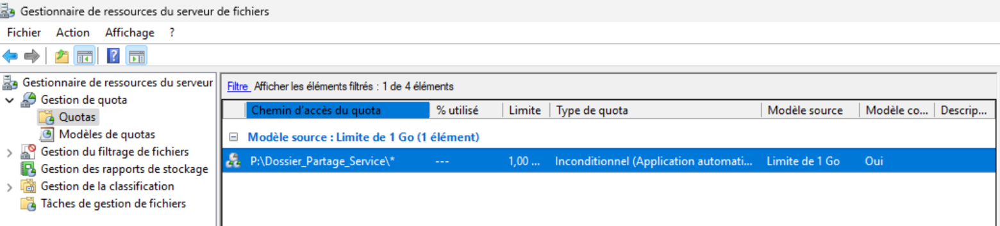

**Test** : le dépôt d'un fichier qui dépasse la limite échoue avec le message « Espace disque insuffisant ». Un événement est consigné dans le journal Application et une notification par e-mail est envoyée selon le modèle.

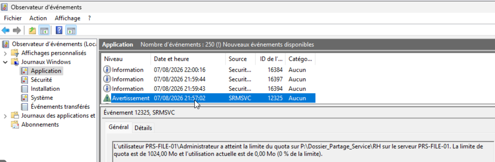

### Filtrage des extensions

Un filtrage **actif** bloque, sur chaque dossier de service, les **exécutables et les images ISO**. Le groupe de fichiers « Fichiers exécutables » fourni par défaut est complété par l'extension `*.iso`, puis appliqué par un modèle de filtre actif.

Contrairement aux quotas, FSRM n'applique pas automatiquement un filtre aux sous-dossiers existants et futurs. Un filtre est donc créé pour **chaque** dossier de service.

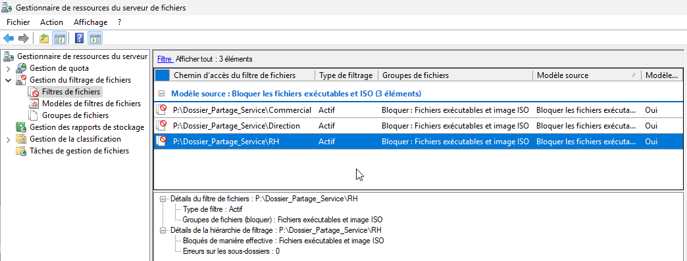

**Test** : le dépôt d'un fichier `.exe` est refusé, et un événement est consigné avec le fichier concerné, le groupe de fichiers correspondant et le dossier visé.

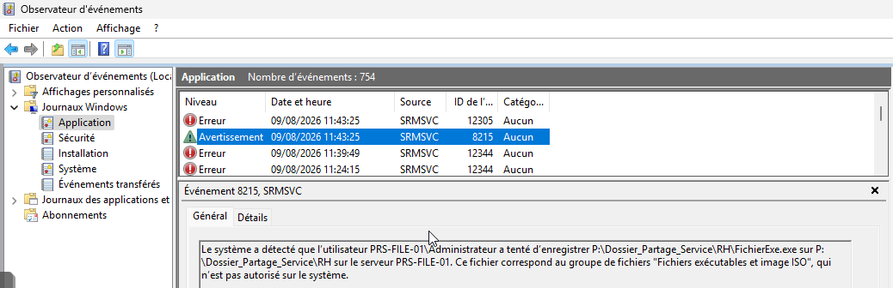

### Classification automatique

La classification ajoute des propriétés personnalisées aux fichiers selon leur contenu. Une propriété **« Confidentiel »** (Oui/Non) est mise en place sur le dossier **Direction** :

- une première règle positionne « **Oui** » si le terme `Confidentiel` apparaît au moins une fois dans le fichier ;
- une seconde règle positionne « **Non** » en l'absence du terme, les deux règles étant nécessaires ;
- les **Microsoft Office Filter Packs** rendent le contenu des fichiers Office analysable ;
- la classification s'exécute chaque jour, en dehors des heures ouvrées, avec réévaluation des propriétés existantes.

**Test** : après exécution de la tâche, l'onglet *Classification* des propriétés Windows affiche « Confidentiel : Oui » pour les fichiers contenant le terme et « Non » pour les autres.


### Audit d'accès

L'audit repose sur deux éléments complémentaires.

Une **GPO d'audit** (`Audit_Files_Folders_Access`) active la journalisation de l'accès aux objets, en réussite comme en échec. Elle est liée à l'OU du serveur de fichiers, avec un filtrage de sécurité limité à ce serveur.


Des **SACL** posées sur le dossier racine des services définissent les actions à journaliser et se propagent aux dossiers de service existants et futurs. Sont audités, en réussite comme en échec, pour les **Utilisateurs du domaine** : la lecture, la création de fichiers et de dossiers, la suppression et la modification des permissions NTFS.


Les événements sont consultables dans le journal **Sécurité** de l'Observateur d'événements, catégorie *File System*.


---

## Conclusion

`PRS-FILE-01` combine trois briques cohérentes avec le reste de l'infrastructure : des partages de service structurés selon le modèle AGDLP, déjà utilisé pour la PRP du RODC et pour l'accès RDS ; une redirection de profils itinérants avec fichiers hors connexion, qui assure la continuité entre Paris et Lyon ; et un rôle FSRM complet, qui apporte maîtrise et traçabilité de l'espace de stockage.

Les tests réalisés (accès effectifs par groupe, redirection de dossiers, dépassement de quota, dépôt de fichier bloqué, classification et journalisation) confirment le bon fonctionnement de l'ensemble. 

---
[← Annuaire](2-annuaire.md) · [Sommaire](../README.md) · [Serveur RDS →](4-rds.md)
