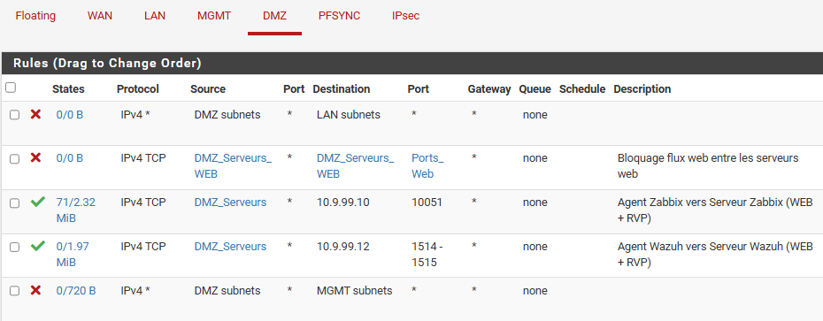
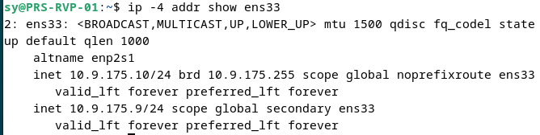
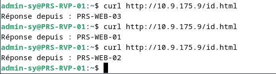
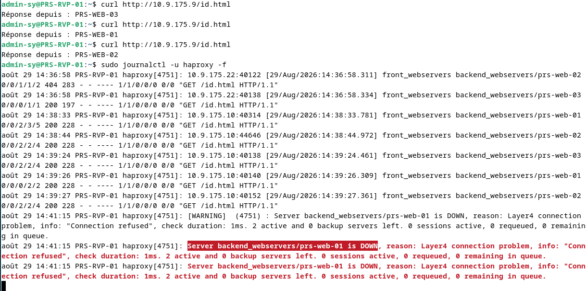
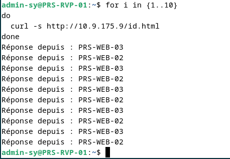
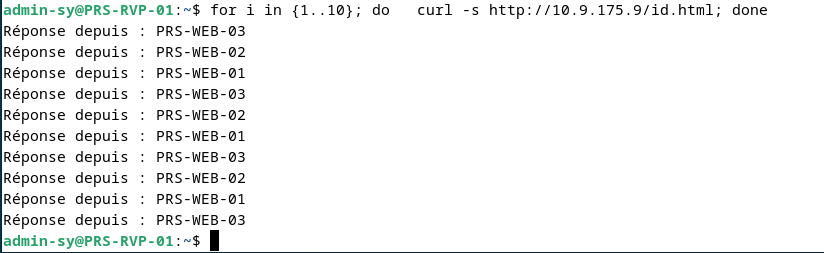
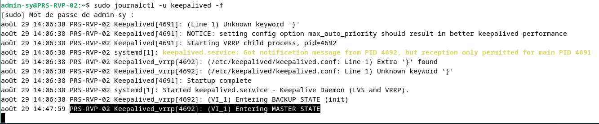
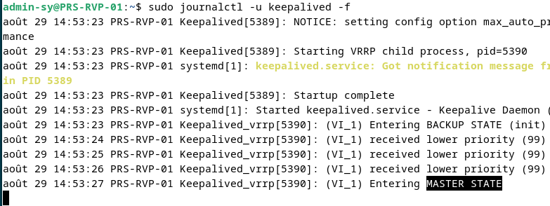
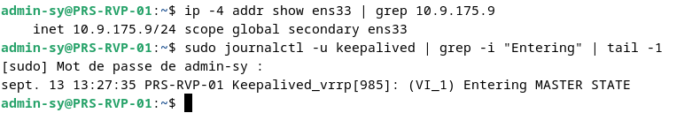

# DMZ : serveurs web, répartition de charge et haute disponibilité

[← Retour au projet](../README.md)

## Introduction

La **DMZ de Paris** héberge exclusivement les services destinés à être exposés : trois **serveurs web Nginx** placés derrière deux **reverse proxy HAProxy**, rendus hautement disponibles par **Keepalived**. Elle repose sur trois principes :

- un **point d'entrée unique** : les utilisateurs ne contactent jamais directement un serveur web ou un nœud HAProxy, mais toujours l'adresse virtuelle `10.9.175.9` ;
- une **répartition de charge** entre les trois serveurs web, avec retrait automatique d'un serveur défaillant ;
- une **haute disponibilité** à chaque niveau : si un serveur web ou un nœud HAProxy tombe, le service reste disponible.

L'ensemble est encadré par des règles pfSense qui isolent la DMZ du LAN et du réseau de management : aucun flux ne peut être initié depuis la DMZ vers le LAN.

---

## Architecture

### Machines et adressage

| Machine            | Adresse IP    | Rôle                                                     |
|--------------------|---------------|----------------------------------------------------------|
| **PRS-FW-DMZ-VIP** | `10.9.175.1`  | Passerelle de la DMZ (VIP CARP pfSense)                  |
| **PRS-RVP-VIP**    | `10.9.175.9`  | Adresse virtuelle partagée (VRRP), point d'entrée unique |
| **PRS-RVP-01**     | `10.9.175.10` | Reverse proxy HAProxy + Keepalived, **MASTER**           |
| **PRS-RVP-02**     | `10.9.175.11` | Reverse proxy HAProxy + Keepalived, **BACKUP**           |
| **PRS-WEB-01**     | `10.9.175.20` | Serveur web Nginx (backend)                              |
| **PRS-WEB-02**     | `10.9.175.21` | Serveur web Nginx (backend)                              |
| **PRS-WEB-03**     | `10.9.175.22` | Serveur web Nginx (backend)                              |

### Chaîne de traitement d'une requête

```
            Utilisateurs
                  │  HTTP (TCP 80)
                  ▼
           VIP 10.9.175.9 ─ portée par le nœud MASTER (VRRP)
                  │
                  ▼
 ┌────────────────────────────────┐
 │            HAProxy             │   PRS-RVP-01 (MASTER) / PRS-RVP-02 (BACKUP)
 │   round-robin + health check   │
 └────────────────┬───────────────┘
                  │
   ┌──────────────┼───────────────┐
   ▼              ▼               ▼
 PRS-WEB-01   PRS-WEB-02   PRS-WEB-03
    Nginx       Nginx        Nginx
```

---

## Serveurs web Nginx

**Nginx** est installé à l'identique sur `PRS-WEB-01`, `PRS-WEB-02` et `PRS-WEB-03`. Chaque serveur sert le contenu applicatif de Freemotion derrière les reverse proxy.

---

## Cloisonnement : règles pfSense

Les règles pfSense autorisent uniquement les flux nécessaires au fonctionnement de la plateforme et maintiennent un cloisonnement strict de la DMZ. Elles s'appuient sur trois alias :

| Alias              | Contenu                                            |
|--------------------|----------------------------------------------------|
| `DMZ_Serveurs_WEB` | Les trois serveurs web `PRS-WEB-01` à `PRS-WEB-03` |
| `DMZ_Serveurs`     | Les serveurs web et les reverse proxy de la DMZ    |
| `Ports_Web`        | Ports des services web                             |

### Interface DMZ

| Ordre | Action        | Source             | Destination        | Port            | Rôle                                                        |
|-------|---------------|--------------------|--------------------|-----------------|-------------------------------------------------------------|
| 1     | **Bloquer**   | Sous-réseaux DMZ   | Sous-réseaux LAN   | Tous            | Interdit tout rebond de la DMZ vers le LAN                  |
| 2     | **Bloquer**   | `DMZ_Serveurs_WEB` | `DMZ_Serveurs_WEB` | TCP `Ports_Web` | Bloque les flux web entre les serveurs web                  |
| 3     | **Autoriser** | `DMZ_Serveurs`     | `10.9.99.10`       | TCP `10051`     | Agents Zabbix vers le serveur Zabbix (web + reverse proxy)  |
| 4     | **Autoriser** | `DMZ_Serveurs`     | `10.9.99.12`       | TCP `1514-1515` | Agents Wazuh vers le serveur Wazuh (web + reverse proxy)    |
| 5     | **Bloquer**   | Sous-réseaux DMZ   | Sous-réseaux MGMT  | Tous            | Interdit tout accès de la DMZ au réseau de management       |

- La règle **1** empêche un attaquant qui compromettrait un serveur exposé de rebondir vers le LAN.
- La règle **2** limite la propagation latérale entre les serveurs web : chaque backend ne reçoit du trafic web que du reverse proxy.
- Les règles **3** et **4** sont de **strictes exceptions** pour la supervision : seuls les agents peuvent joindre `ADM-ZABBIX` et `ADM-WAZUH`, sur leurs ports dédiés.
- La règle **5** bloque tout le reste vers le réseau de management. Elle est placée **après** les exceptions, car pfSense évalue les règles de haut en bas et applique la première qui correspond.



### Interface LAN

| Ordre | Action        | Source           | Destination      | Port   | Rôle                                                  |
|-------|---------------|------------------|------------------|--------|-------------------------------------------------------|
| 1     | **Autoriser** | Sous-réseaux LAN | `10.9.175.9`     | TCP 80 | Accès à la plateforme web via HAProxy                 |
| 2     | **Bloquer**   | Sous-réseaux LAN | Sous-réseaux DMZ | Tous   | Blocage général du LAN vers la DMZ pour tout le reste |

L'autorisation HTTP est placée **avant** le blocage général, juste après la règle anti-lockout.

---

## Répartition de charge avec HAProxy

**HAProxy** est installé sur `PRS-RVP-01` et `PRS-RVP-02`. Il répartit les requêtes HTTP entre les trois serveurs web et vérifie en permanence leur disponibilité.

| Élément          | Configuration                                                                                                                 |
|------------------|-------------------------------------------------------------------------------------------------------------------------------|
| **Frontend**     | `front_webservers` : écoute sur la VIP `10.9.175.9` (et non sur l'adresse propre du nœud)                                     |
| **Backend**      | `backend_webservers` : `prs-web-01`, `prs-web-02` et `prs-web-03`                                                             |
| **Algorithme**   | **Round-robin** : les requêtes sont distribuées tour à tour entre les serveurs                                                |
| **Health check** | Contrôle de niveau 4 (connexion TCP) : un serveur en échec est retiré de la rotation sans interruption pour les utilisateurs |

### Écoute sur une adresse non locale

Le nœud BACKUP ne porte pas la VIP tant qu'il n'est pas MASTER. Pour qu'HAProxy puisse tout de même démarrer et écouter sur cette adresse, le paramètre noyau `ip_nonlocal_bind` est activé sur les deux nœuds :

```bash
echo "net.ipv4.ip_nonlocal_bind=1" | sudo tee -a /etc/sysctl.conf
sudo sysctl -p
```

Les deux nœuds sont ainsi prêts à accueillir la VIP et le service associé, quel que soit celui qui est actif à un instant donné.

---

## Haute disponibilité avec Keepalived

**Keepalived** assure, via le protocole **VRRP**, la bascule automatique de la VIP `10.9.175.9` entre `PRS-RVP-01` (nœud prioritaire) et `PRS-RVP-02` (nœud de secours).

### Configuration

Configuration de `PRS-RVP-01` (MASTER) :

```
vrrp_instance VI_1 {
    state MASTER
    interface ens33
    virtual_router_id 51
    priority 100
    advert_int 1
    authentication {
        auth_type PASS
        auth_pass ****
    }
    virtual_ipaddress {
        10.9.175.9/24
    }
}
```

Le fichier de `PRS-RVP-02` est identique, à l'exception de `state BACKUP` et de `priority 99`.

| Paramètre                          | Rôle                                                                                                      |
|------------------------------------|-----------------------------------------------------------------------------------------------------------|
| `priority` (100 / 99)              | Le nœud de priorité la plus haute porte la VIP : la différence détermine le MASTER                        |
| `virtual_router_id` et `auth_pass` | Doivent être **identiques** sur les deux nœuds, ce qui les fait reconnaître comme un même groupe VRRP    |
| `advert_int 1`                     | Le MASTER émet une annonce VRRP chaque seconde ; leur absence déclenche la bascule                        |

La VIP est portée par l'interface `ens33` du nœud MASTER, en **adresse secondaire** à côté de son adresse propre :



Depuis un navigateur, l'accès à la VIP `http://10.9.175.9` renvoie la page d'accueil Nginx du serveur qui répond (ici « Welcome to nginx on Web 1! »).


---

## Tests de validation

Chaque nœud web expose une page de test minimale, `id.html`, qui affiche uniquement son nom (`Réponse depuis : PRS-WEB-0x`). Chaque requête de test interroge cette page à travers la VIP `10.9.175.9`, ce qui permet de suivre en direct quel serveur backend traite chaque requête.

| Test                                     | Résultat                                                                                                                |
|------------------------------------------|-------------------------------------------------------------------------------------------------------------------------|
| Répartition round-robin (état nominal)   | **Conforme** : les trois serveurs backend répondent tour à tour                                                         |
| Panne d'un serveur web (`PRS-WEB-01`)    | **Conforme** : panne détectée par HAProxy, serveur retiré de la rotation, répartition maintenue sur les deux restants  |
| Retour du serveur web                    | **Conforme** : retour à une répartition normale sur les trois serveurs                                                  |
| Bascule Keepalived (arrêt du MASTER)     | **Conforme** : `PRS-RVP-02` passe de BACKUP à MASTER et reprend la VIP                                                  |
| Continuité de service pendant la bascule | **Conforme** : la répartition reste opérationnelle avec `PRS-RVP-02` comme MASTER                                       |
| Retour à la normale (failback)           | **Conforme** : `PRS-RVP-01` reprend automatiquement l'état MASTER grâce à sa priorité supérieure                        |

### Répartition de charge

Trois requêtes successives sur la VIP, depuis `PRS-RVP-01`, sont traitées par trois serveurs différents : la répartition round-robin fonctionne dès la mise en service.



### Panne d'un serveur backend

Le journal HAProxy de `PRS-RVP-01` (`journalctl -u haproxy -f`) montre d'abord les requêtes sur `id.html` distribuées tour à tour vers `prs-web-01`, `prs-web-02` et `prs-web-03` via `front_webservers` → `backend_webservers`.

Le service web est ensuite arrêté volontairement sur `PRS-WEB-01`. HAProxy signale le serveur en échec (`Server backend_webservers/prs-web-01 is DOWN`) et le retire de la rotation : il reste **2 serveurs actifs**, sans session perdue ni requête en attente (`0 sessions active, 0 requeued, 0 remaining in queue`).



Pendant la panne, dix requêtes consécutives sont réparties uniquement entre `PRS-WEB-02` et `PRS-WEB-03` :



Une fois le service restauré sur `PRS-WEB-01`, la répartition revient sur les trois serveurs :



### Bascule Keepalived

Le journal Keepalived de `PRS-RVP-02` montre le service démarré en état **BACKUP** (`Entering BACKUP STATE (init)`). À l'arrêt du nœud MASTER `PRS-RVP-01`, il cesse de recevoir les annonces VRRP, passe à l'état **MASTER** et reprend ainsi la VIP.



### Retour à la normale (failback)

Au redémarrage de Keepalived, `PRS-RVP-01` entre d'abord en état BACKUP et reçoit pendant trois secondes les annonces VRRP de `PRS-RVP-02` (`received lower priority (99)`, inférieure à la sienne). Il reprend ensuite l'état **MASTER** environ quatre secondes plus tard. Ce comportement valide le principe de **préemption par priorité**.



La VIP est de nouveau portée par `PRS-RVP-01` :



---

## Conclusion

La DMZ de Paris repose sur une chaîne complète, installée et testée : trois serveurs web Nginx redondants, répartis en round-robin par une paire HAProxy rendue hautement disponible par Keepalived/VRRP. Des règles pfSense isolent strictement la DMZ du LAN et du réseau de management, à l'exception des flux de supervision.

Les tests (panne d'un serveur backend, bascule puis retour du nœud MASTER) confirment qu'aucune interruption durable du service n'est constatée côté client.

---

[← RDS](4-rds.md) · [Sommaire](../README.md) · [Supervision →](6-supervision.md)
