# Supervision : surveillance de l'infrastructure et SIEM

[← Retour au projet](../README.md)

[← DMZ](5-dmz.md)

## Introduction

Une infrastructure redondante n'est fiable que si ses défaillances sont visibles. La **supervision** de Freemotion répond à deux questions distinctes : *les services fonctionnent-ils ?* et *le SI est-il attaqué ?* Deux briques complémentaires, déployées sur le réseau **Management** (`10.9.99.0/24`), y répondent :

- **Zabbix** surveille la **disponibilité opérationnelle** : machines, métriques, disponibilité des services ;
- **Wazuh** assure la **détection de sécurité** : journaux des hôtes, réponse active.

Chaque brique est validée par des tests de panne ou d'attaque volontaires. Ils vérifient non seulement que les alertes remontent, mais aussi qu'elles se résolvent ou déclenchent une réaction automatiquement.

| Machine      | Adresse IP   | Rôle                 |
|--------------|--------------|----------------------|
| `ADM-ZABBIX` | `10.9.99.10` | Serveur Zabbix       |
| `ADM-WAZUH`  | `10.9.99.12` | Serveur Wazuh (SIEM) |

Les deux serveurs sont hébergés dans la zone Management, strictement isolée : seuls les flux techniques nécessaires, des agents vers les serveurs, y sont autorisés, et les interfaces d'administration restent réservées au LAN de Paris.

---

## Zabbix

### Installation et déploiement des agents

Le serveur `ADM-ZABBIX` est installé sur le réseau Management. Un agent Zabbix est déployé sur les **seize hôtes** du périmètre : SIEM, pare-feux pfSense de Paris et de Lyon, contrôleurs de domaine, RODC, serveur de fichiers, serveur RDS, nœuds HAProxy et serveurs web.

Deux modes d'interrogation sont utilisés :

| Hôtes             | Mode   | Sens du flux                                | Port      |
|-------------------|--------|---------------------------------------------|-----------|
| Parc général      | Actif  | L'agent initie la connexion vers le serveur | TCP 10051 |
| Pare-feux pfSense | Passif | Le serveur interroge l'agent                | TCP 10050 |

> [!NOTE]
> **pfSense en mode passif :** Les agents FreeBSD présentent un comportement instable en mode actif sur les pare-feux. Le mode passif contourne ce problème sans impact sur la volumétrie ni sur la fraîcheur des données collectées.

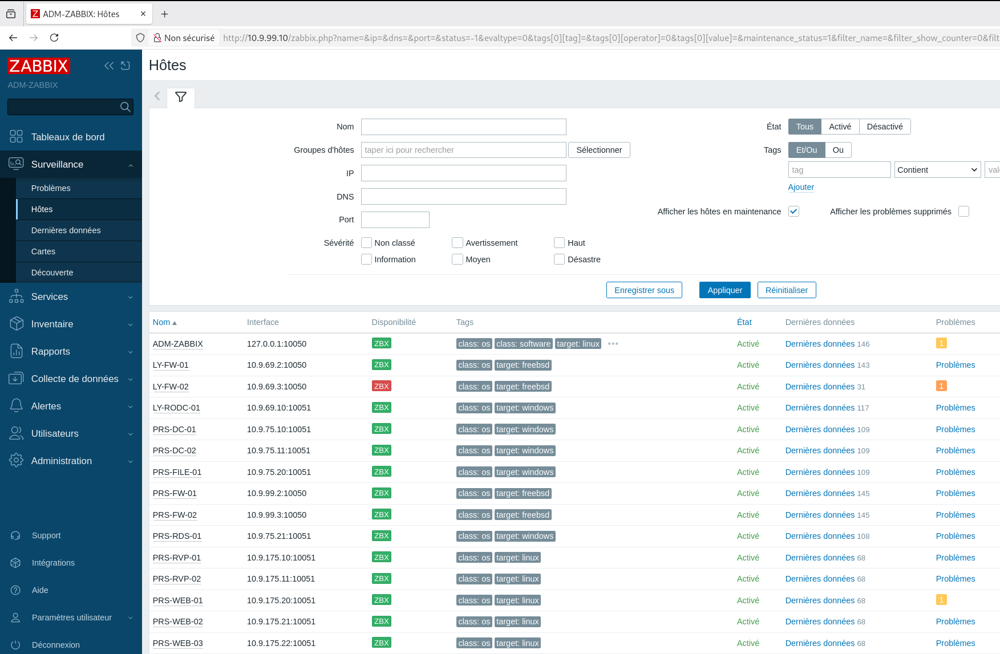

### Règles de pare-feu

Les flux de supervision entre Paris et Lyon transitent par le tunnel IPsec, sur des ports dédiés. Deux types de règles sont nécessaires :

- **Agents passifs (pfSense)** : une règle sur l'interface MGMT autorise explicitement le serveur Zabbix à interroger chaque agent sur le port `10050`, plutôt que d'ouvrir un flux générique vers tout le sous-réseau ;
- **Agents actifs** : une règle symétrique autorise l'agent à joindre le serveur sur le port `10051`.

### Comportement du nœud BACKUP à Lyon

À Lyon, le serveur Zabbix atteint les pare-feux à travers le tunnel VPN, adossé à la **VIP WAN**. Seul le nœud pfSense actif au sens CARP porte cette VIP. Le nœud BACKUP (`LY-FW02`) n'est donc pas joignable tant qu'il n'a pas basculé en MASTER, et il apparaît régulièrement indisponible dans l'inventaire.

Un test de bascule confirme ce comportement : une fois le nœud de secours passé en MASTER, son statut redevient disponible.

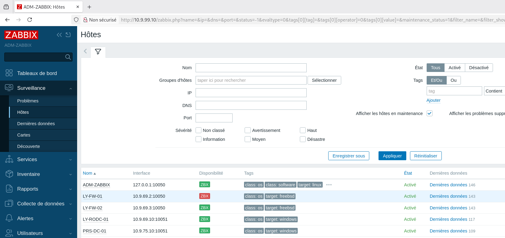

> [!WARNING]
> **Limite connue.** Ce comportement est inhérent à l'architecture CARP et ne relève pas d'une anomalie de configuration. Une dépendance de déclencheur fondée sur le rôle CARP du nœud actif permettrait de supprimer automatiquement cette alerte attendue : c'est une piste d'amélioration.

### Surveillance de HAProxy

Les deux nœuds `PRS-RVP-01` et `PRS-RVP-02` sont supervisés avec le modèle officiel **HAProxy by Zabbix agent 2**, qui interroge nativement la page de statistiques HAProxy exposée sur le port `8404`.

- Les **macros d'hôte** `{$HAPROXY.*}` définissent les identifiants et le schéma d'accès à cette page.
- La page de statistiques est joignable **indépendamment sur chaque nœud**, afin que la supervision reste possible quel que soit celui qui porte la VIP.

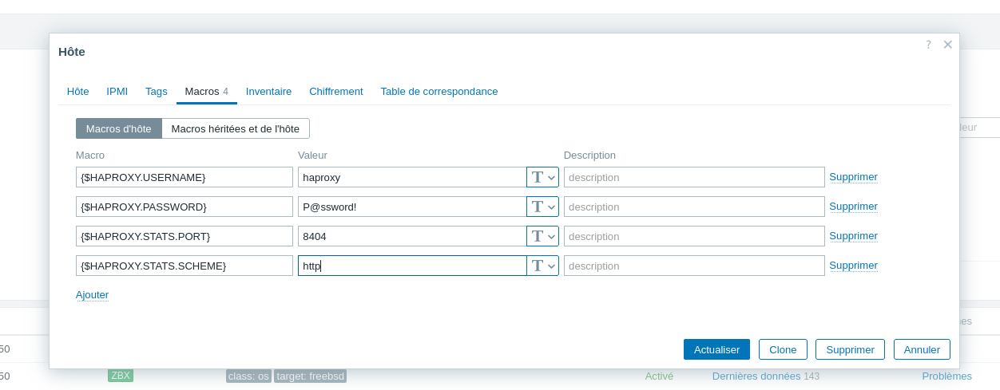

**Test** : le service HAProxy est arrêté volontairement sur `PRS-RVP-01` :

```bash
sudo systemctl stop haproxy
```

Le déclencheur « HAProxy: Service is down » remonte en quelques secondes, avec une sévérité **Moyenne**. Au redémarrage du service, le problème se résout automatiquement grâce au mode natif de Zabbix, sans fermeture manuelle.

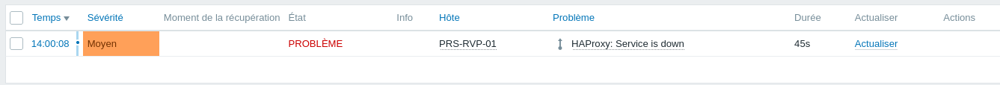

### Surveillance du tunnel VPN inter-site

Le tunnel IPsec Paris-Lyon est suivi par un élément dédié, **« État tunnel IPsec »** (clé `vpn.ipsec.established`), défini sur chaque pare-feu par un `UserParameter`. Celui-ci exécute un test de connectivité fonctionnel vers l'extrémité distante du tunnel, sans droits particuliers sur l'agent.

Un déclencheur de sévérité **Haute** signale toute perte de connectivité, avec la même résolution automatique que pour HAProxy.

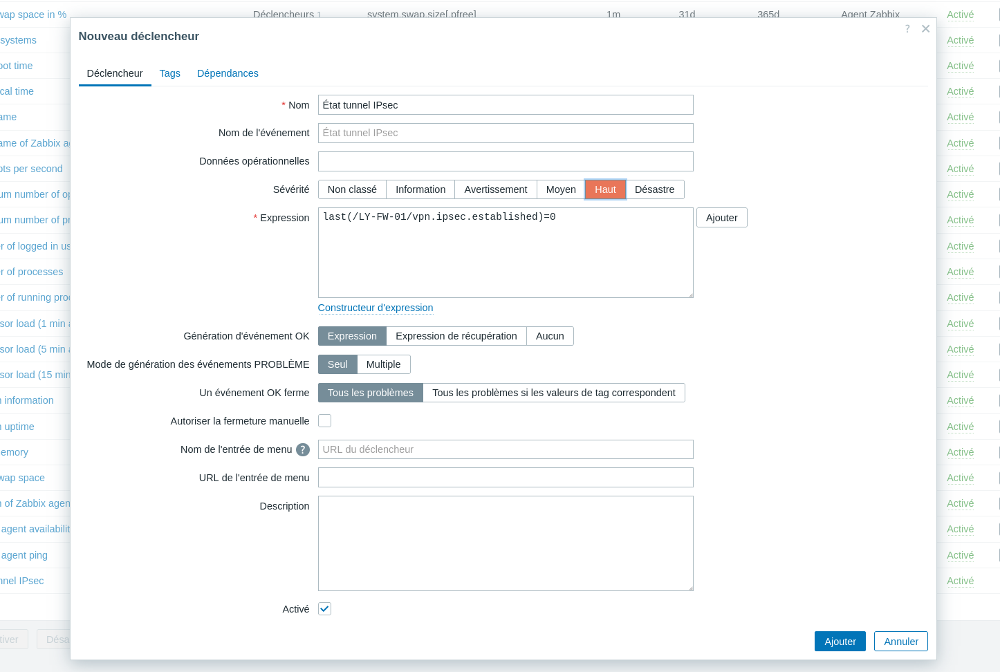

**Test** : le VPN est coupé volontairement. Le problème remonte dès la chute du tunnel, puis se résout au rétablissement.

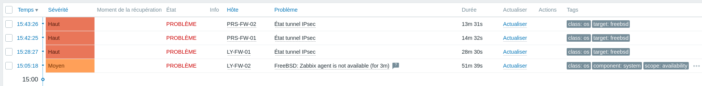

### Supervision croisée de Wazuh

Un agent Zabbix actif est également déployé sur `ADM-WAZUH`, afin de surveiller la disponibilité de la machine hébergeant la détection et de suivre sa consommation mémoire. En retour, un agent Wazuh est installé sur `ADM-ZABBIX` : chaque brique surveille l'autre.

### Conclusion Zabbix

La supervision couvre l'ensemble du parc en disponibilité de base, ainsi que deux briques critiques testées de bout en bout : la haute disponibilité HAProxy en DMZ et le tunnel VPN inter-site. Les coupures volontaires confirment une **détection en quelques secondes** et une **résolution automatique** au retour à la normale.

---

## Wazuh

### Installation et déploiement des agents

Le serveur `ADM-WAZUH` est installé sur le réseau Management, aux côtés de Zabbix. Un agent est déployé sur les **onze hôtes** Linux et Windows du périmètre : serveurs web, reverse proxy, contrôleurs de domaine, RODC, serveur de fichiers et serveur RDS.

Les pare-feux pfSense sont exclus de cette liste, Wazuh ne publiant pas de paquet agent officiel pour FreeBSD.

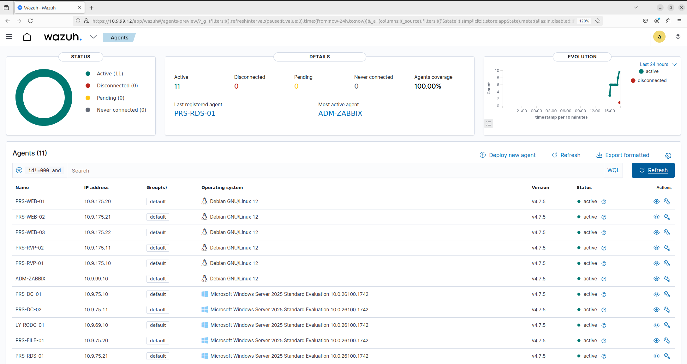

### Intégration syslog des pare-feux pfSense

**Option écartée.** Une méthode communautaire consiste à activer temporairement les dépôts FreeBSD génériques sur pfSense pour y installer l'agent. Netgate la déconseille explicitement sur un pare-feu de production, en raison du risque de conflit avec le système de paquets propre à pfSense. Ce risque est jugé disproportionné sur un composant réseau critique en haute disponibilité CARP.

**Option retenue.** Les journaux sont remontés par **syslog UDP**, sans installation ni connexion d'administration supplémentaire sur le pare-feu. Chaque pfSense (`PRS-FW01/02`, `LY-FW01/02`) transmet ses événements Firewall et VPN vers `ADM-WAZUH` sur le port `514/UDP`.

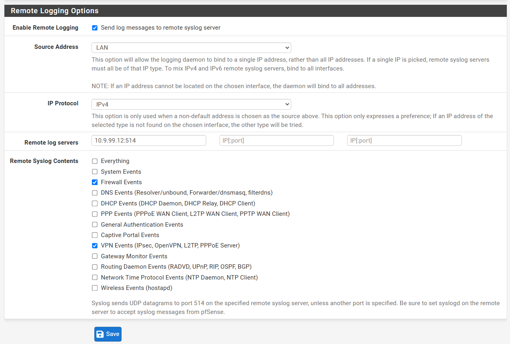

Un décodeur et un jeu de règles dédiés extraient et classent les champs du journal `filterlog` (interface, action, direction, protocole) :

| Fichier             | Rôle                                                                             |
|---------------------|----------------------------------------------------------------------------------|
| `local_decoder.xml` | Décodeur du journal `filterlog` pfSense                                          |
| `local_rules.xml`   | Règle de niveau 5 sur le trafic bloqué, règle de niveau 7 sur les tentatives ICMP |

Ces niveaux garantissent que les événements sont effectivement indexés en alerte.

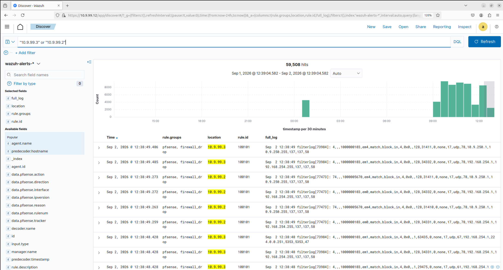

### Règles de pare-feu du flux syslog

Le flux n'est autorisé que de manière explicite, sans ouverture générique du sous-réseau Management. La règle couvre le bloc `/30` des deux nœuds CARP du site, afin que le flux reste autorisé quel que soit le nœud qui porte la VIP.

| Site  | Emplacement de la règle | Source                         | Destination          |
|-------|-------------------------|--------------------------------|----------------------|
| Paris | Interface MGMT          | `10.9.99.0/30` (`PRS-FW01/02`) | `10.9.99.12:514/UDP` |
| Lyon  | Interface IPsec         | `10.9.69.0/30` (`LY-FW01/02`)  | `10.9.99.12:514/UDP` |

> [!NOTE]
> **Interface IPsec à Lyon :** Le flux transite par le tunnel inter-site. L'interface IPsec est le seul emplacement où pfSense filtre le trafic déjà déchiffré en sortie de tunnel.

> [!WARNING]
> **Limite connue.** Comme pour Zabbix, seul le nœud pfSense actif au sens CARP dispose d'une association de sécurité IPsec et peut transmettre son syslog à travers le tunnel. Le nœud BACKUP conserve la configuration répliquée mais reste sans tunnel tant qu'il n'a pas basculé. La visibilité n'est pas affectée en fonctionnement normal, car le flux suit la bascule de la VIP.

### Test de force brute SSH et réponse active

La capacité de réponse active est testée en conditions réelles, depuis une machine attaquante extérieure au périmètre de confiance :

1. une attaque par force brute SSH est lancée avec **Hydra** contre `PRS-WEB-01` (`10.9.175.20`, agent Wazuh actif), à partir d'un dictionnaire de mots de passe ;
2. les échecs répétés déclenchent la règle **5760** (`sshd: authentication failed`), puis, au seuil de répétition, la règle **5763** (`sshd: brute force trying to get access to the system`) ;
3. la réponse active `firewall-drop`, déclarée dans `ossec.conf`, se déclenche automatiquement : l'IP de l'attaquant est bloquée sur le pare-feu local du serveur, ce que journalise la règle **651** ;
4. un ping depuis l'attaquant, auparavant joignable, subit désormais **100 % de perte de paquets**.

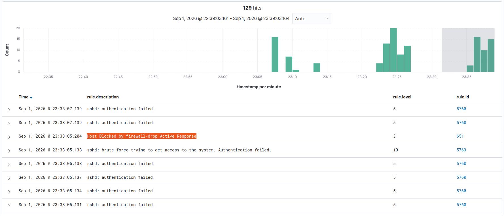

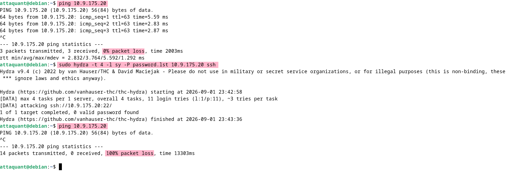

Aucune intervention manuelle n'est nécessaire entre la détection et le blocage.

### Conclusion Wazuh

Wazuh apporte une détection distincte et complémentaire de Zabbix : couverture hôte sur onze agents Linux et Windows, télémétrie des quatre pare-feux pfSense par syslog, et réponse active validée de bout en bout, de la détection au blocage automatique de l'attaquant.

---

## Synthèse

| Test                                 | Résultat                                                                  |
|--------------------------------------|---------------------------------------------------------------------------|
| Agents Zabbix sur l'ensemble du parc | 16 hôtes supervisés                                                       |
| Arrêt volontaire de HAProxy          | Détecté en quelques secondes, résolution automatique                      |
| Coupure volontaire du tunnel VPN     | Détectée, résolution automatique au rétablissement                        |
| Syslog pfSense vers Wazuh            | Événements de blocage et ICMP indexés                                     |
| Force brute SSH (Hydra)              | Règles 5760 et 5763, blocage `firewall-drop` (règle 651), 100 % de perte |

---

## Conclusion

La supervision de Freemotion combine deux approches complémentaires, hébergées dans une zone Management isolée. **Zabbix** garantit la visibilité sur la disponibilité des seize hôtes et des briques critiques (HAProxy, tunnel VPN), tandis que **Wazuh** couvre la détection de sécurité, des journaux des hôtes jusqu'à la télémétrie des pare-feux pfSense. La supervision croisée des deux serveurs évite qu'une panne de l'un passe inaperçue.

Les tests de bout en bout (arrêt de HAProxy, coupure du VPN, attaque par force brute SSH) confirment une détection en quelques secondes et une réaction automatique, sans intervention manuelle. Les limites identifiées, liées au fonctionnement de CARP sur les nœuds BACKUP, sont comprises et documentées, avec une piste d'amélioration par dépendance de déclencheurs.

---

[← DMZ](5-dmz.md) · [Sommaire](../README.md)
